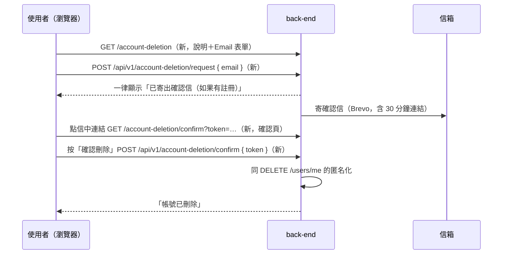

# Plan：刪除帳號申請網頁（Account Deletion Web）

## 目標

Google Play「資料安全性」表單要求：有帳號功能的 App 除了 App 內刪除（已完成，見 `plan-delete-account.md`），還要提供一個**網址**，讓已經刪掉 App 的使用者也能申請刪除帳號。

完成的定義：有一個公開網址，使用者輸入 Email 後收到確認信，點信中連結、在網頁上再按一次確認，帳號就立即刪除（跟 App 內刪除同一套匿名化）；App 的隱私權政策頁寫出這個網址；上架時把網址填進 Google Play Console。

### 使用者 2026-11-09 定案的決策

| 題目 | 決定 |
|---|---|
| 處理方式 | **寄確認信、點連結確認後立即刪除**（比照 Magic Link，全自動、不用人工處理） |
| 適用帳號 | **所有登入方式都可以**，只要帳號的 Email 收得到信；沒有 Email 的帳號（部分 LINE 帳號）網頁請他從 App 內刪除 |

## 規則（提案）

- 申請時不透露 Email 有沒有註冊：一律顯示「如果這個 Email 有註冊，我們已寄出確認信」
- 確認連結單次使用、**30 分鐘**有效
- 信件連結打開的是確認頁，要**再按一次按鈕**才刪除（避免信箱安全掃描機器人自動點開就把帳號刪了，同 Magic Link 的做法）
- 刪除內容與保留內容完全比照 `DELETE /users/me`（個資、點數、未使用優惠券、好友、通知、推播 token、續期證、發票載具刪除；交易紀錄保留但匿名化）
- `role=staff` 帳號：確認頁顯示「店員帳號無法自行刪除，請聯絡管理者」，不刪除
- 申請頻率限制：同一個 Email 每分鐘 1 次、每天 5 次，超過也顯示同樣的訊息（不寄信）

## 架構／流程

## API 與頁面（back-end 2026-11-09 照提案實作，`cc14ab5`；店員 403 的 error_code 是 `staff_account`）

- `GET /account-deletion`：公開 HTML（繁體中文、手機版面），說明會刪除／保留什麼、Email 輸入框
- `POST /api/v1/account-deletion/request`，body `{ email }` → 一律 `204`
- `GET /account-deletion/confirm?token=`：確認頁，顯示遮罩後的 Email（例如 `st***@hotmail.com`）與「確認刪除」按鈕；token 無效／過期顯示「連結已失效，請重新申請」
- `POST /api/v1/account-deletion/confirm`，body `{ token }` → 刪除成功 `204`；token 無效 `400 { error_code: "invalid_deletion_token" }`；店員 `403`
- 正式網址例如 `https://fastapi-pj-2.onrender.com/account-deletion`（之後有自己的網域再換）

## Scope

### May modify（mynotification）
- `app/(drawer)/privacy.tsx` — 「刪除帳號」段落加上網址（App 內刪除之外，也可以透過網頁申請）
- `app/delete-account.tsx` — 說明文字下方加一行網址（可選，方便使用者知道）
- `CLAUDE.md`

### 分工
- **back-end**：兩個 HTML 頁面、兩支 API、確認 token（單次、30 分鐘）、頻率限制、寄信（沿用 Magic Link 的 Brevo）、刪除邏輯共用 `DELETE /users/me`
- **staff-scanner**：不用改
- **使用者**：上架時把網址填進 Google Play Console「資料安全性 → 刪除帳號網址」

## 驗證
1. **正常刪除**：用一個測試帳號的 Email 在網頁申請 → 收到信 → 點連結 → 按確認 → 顯示已刪除；App 裡該帳號下次操作被登出、無法再登入
2. **防誤刪**：只點信中連結、不按確認 → 帳號還在；同一個連結確認後再點一次 → 顯示失效
3. **不透露帳號存在**：輸入沒註冊的 Email → 一樣顯示「已寄出確認信（如果有註冊）」，但沒有信
- 店員帳號申請 → 確認頁顯示請聯絡管理者

## 完成條件
- [x] back-end 部署（`cc14ab5`，migration `d26e7a875d8b`）
- [x] 前端隱私權政策頁更新
- [x] 驗證 1～3 通過（2026-11-09：使用者用 stevenchouis@yahoo.com 實際收信、點連結、確認刪除成功；其他情況 back-end 驗證）
- [x] CLAUDE.md 更新

## 風險與還原
- 風險：有人知道別人的 Email 就來亂申請。處理：一定要收得到信、點連結再按確認才會刪；頻率限制避免被拿來轟炸信箱
- 還原：拿掉網頁即可，刪除邏輯是既有的
