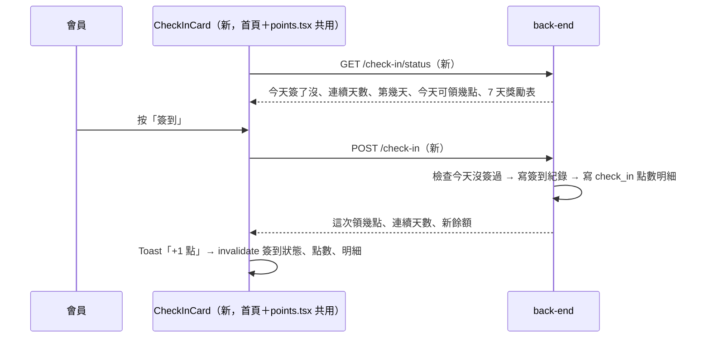

# Plan：每日簽到（Daily Check-in）

## 目標

會員每天打開 App 簽到領點數，連續簽到有加碼，讓會員養成每天回來看看的習慣（順便看到首頁的活動輪播與商品）。

完成的定義：首頁「歡迎回來」下方有一張簽到卡，顯示 7 天進度與今天可領幾點；按「簽到」後點數立即入帳、卡片變成「今天已簽到」；紅利點數頁也看得到同一張卡；點數明細多一筆「每日簽到」紀錄。

### 使用者 2026-11-08 定案的決策

| 題目 | 決定 |
|---|---|
| 獎勵 | **每天 1 點，連續第 7 天 5 點**（一輪 11 點），簽滿 7 天後重新一輪；中斷就從第 1 天重算 |
| 入口 | **首頁卡片＋紅利點數頁** |
| 提醒推播 | **先不要** |

## 規則（提案）

- 「一天」以**台灣時間 00:00** 為界
- 連續：昨天有簽到，今天簽就是連續；昨天沒簽，今天從第 1 天開始
- 一輪第幾天 `cycle_day = ((streak - 1) % 7) + 1`，第 7 天領 5 點，其餘 1 點
- 簽到點數跟消費點數一樣 **1 年後過期**、扣點時一起依到期日先後扣
- **不套用**會員等級倍率、**不計入**年度消費
- 每人每天只能簽一次（後端以 `(user_id, 台灣日期)` 唯一限制擋重複）
- 獎勵數字寫死在後端，前端顯示用後端回傳的 `rewards`，不寫死

## 架構／流程



## API 契約（back-end 2026-11-08 已確認，照提案實作）

**`GET /api/v1/check-in/status`**（需登入）

```json
{
  "checked_in_today": false,
  "streak": 3,
  "cycle_day": 4,
  "today_reward": 1,
  "rewards": [1, 1, 1, 1, 1, 1, 5]
}
```
- `streak`：目前連續簽到天數（今天已簽就含今天；昨天沒簽、今天也還沒簽就是 0）
- `cycle_day`：今天已簽 → 今天是這輪第幾天；今天還沒簽 → 今天簽的話會是第幾天（1～7）
- `today_reward`：今天簽到可領（或已領）的點數

**`POST /api/v1/check-in`**（需登入，不需 body）

- 成功 `201`：`{ "points_awarded": 1, "streak": 4, "cycle_day": 4, "balance": 1235 }`
- 今天已簽過：`409 { "error_code": "already_checked_in", "message": "..." }`

**點數明細新增 type `check_in`**（固定正向），`reason` 例如「每日簽到（第 4 天）」「每日簽到（連續 7 天加碼）」，`expires_at` 有值（1 年後）。

## Scope

### May modify（mynotification）
- `components/CheckInCard.tsx`（新）— 7 個圓點進度、今天可領點數、簽到按鈕／已簽到狀態
- `app/(drawer)/(tabs)/home.tsx` — `HomeHeader` 在搜尋列下方、小輪播上方放 `CheckInCard`；下拉重新整理一併 refetch 簽到狀態
- `app/points.tsx` — 等級卡片下方放 `CheckInCard`；`TX_DISPLAY` 加 `check_in`；到期日顯示也套用到 `check_in`
- `services/checkIn.ts`（新）— `fetchCheckInStatus()`、`checkIn()`、`CHECK_IN_STATUS_QUERY_KEY`
- `types/loyalty.ts` — `check_in` type 與標籤、簽到型別
- `CLAUDE.md` — 紅利點數章節、API 路由表

### Must not modify
- 結帳折抵、兌換、會員等級的既有邏輯
- `services/api.ts`、`store/*`

### 分工
- **back-end**：簽到紀錄表（含唯一限制）、兩支 API、`check_in` 點數明細（1 年效期）、連續天數計算
- **staff-scanner**：不用改

## 既有寫法沿用
- 畫面樣式比照 `MemberTierCard`／`points.tsx`（`useThemeColors` + `createStyles`）
- 錯誤用 `error_code` 判斷（比照兌換）；成功用 `react-native-toast-message`
- 成功後 invalidate：`['loyalty-balance']`（連帶等級）、`['loyalty-transactions']`、`CHECK_IN_STATUS_QUERY_KEY`
- 卡片在 App 從背景回到前景、跨過午夜時要能更新狀態：畫面取得焦點時 refetch 簽到狀態（比照 `points.tsx` 的 `useFocusEffect`）

## 驗證
1. **正常簽到**：今天還沒簽 → 首頁卡片顯示「簽到 +1 點」→ 按下 → Toast「+1 點」、卡片變「今天已簽到」、點數 +1、明細多一筆「每日簽到（第 1 天）」；切到紅利點數頁也是已簽到
2. **重複簽到**：同一天再按（或兩支手機同時按）→ 只入帳一次；後端回 409 時畫面顯示「今天已簽到」不報錯
3. **連續與加碼**（back-end 用測試資料驗證）：連續簽第 7 天領 5 點、第 8 天回到 1 點；中斷一天後從第 1 天重算
- 手動檢查：深淺色模式、首頁版面沒有被擠亂

## 完成條件
- [x] back-end 部署兩支 API 與 `check_in` 明細（`05da59b`，migration `027c10b372e4`）
- [x] 前端完成，驗證 1、2 實機通過，3 由 back-end 驗證（2026-11-08；實測時修正紅利點數頁上方卡片捲不動，改放進 FlatList 的 ListHeaderComponent）
- [x] CLAUDE.md 更新

## 風險與還原
- 風險：使用者跨午夜一直開著 App，卡片停在「今天已簽到」。處理：畫面取得焦點時重抓狀態，按鈕送出時以後端為準
- 風險：舊版 App 遇到 `check_in` 明細。處理：兌換那次已加通用樣式，不會閃退
- 還原：前端拿掉卡片即可；後端 API 是新增的

## Open questions
- ~~type 名稱、回應欄位~~ → back-end 確認照提案；`rewards` 固定 `[1,1,1,1,1,1,5]`；FIFO 扣點、到期收回、到期前 7 天提醒都會包含 `check_in`；第 8 天回 1 點、每輪第 7 天（14、21…）5 點
- back-end 實作：新表 `daily_check_ins(user_id, check_in_date, streak, points)` 唯一限制 `(user_id, check_in_date)`；status 在今天沒簽、昨天有簽時回昨天的 streak；刪除帳號一併刪簽到紀錄；需要一個 migration（待使用者同意）
- ~~店員帳號要不要擋~~ → 不擋
