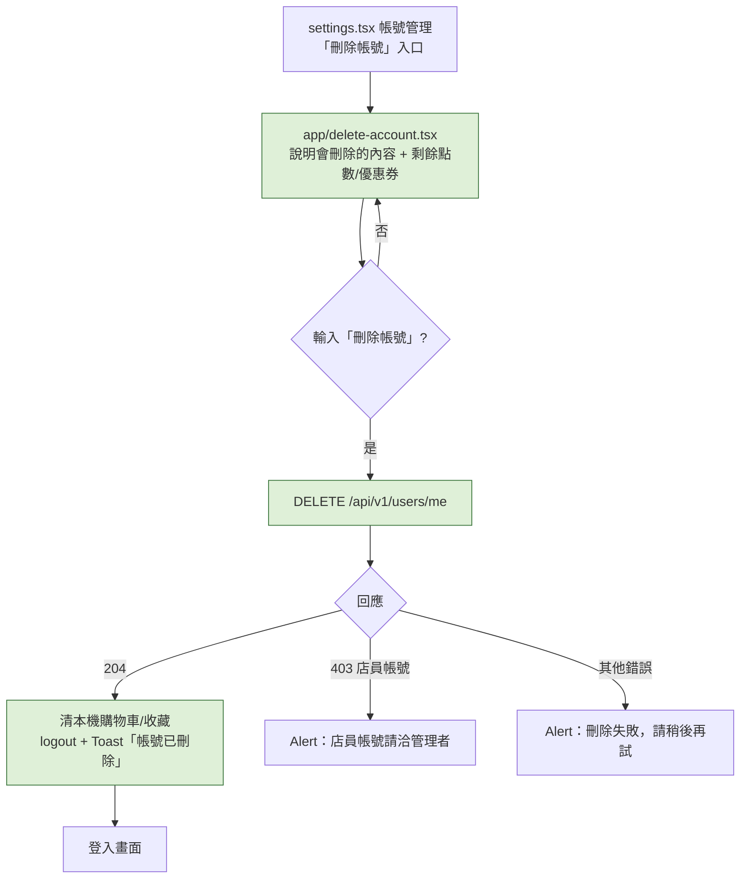

# Plan：App 內刪除帳號（Delete Account）

## 目標

Google Play 與 App Store 都規定：有註冊功能的 App 必須讓使用者**在 App 內自行刪除帳號**，否則審核不通過。目前隱私權政策只寫「請與我們聯繫」，App 內沒有入口。

完成的定義：使用者在「設定 → 帳號管理」點「刪除帳號」，看到會刪除哪些資料（含剩餘點數與可用優惠券數量），輸入「刪除帳號」四個字確認後，帳號立即刪除並登出回登入畫面；之後用同一個 Email 可以重新註冊成一個全新帳號，舊的 JWT 也不能再使用。

### 使用者 2026-11-07 定案的決策

| 題目 | 決定 |
|---|---|
| 資料處理 | **匿名化，保留交易紀錄**：個資清掉、個人相關資料刪除，訂單／堂食紀錄保留但不再對應到任何人 |
| 生效時機 | **立即刪除**，沒有冷靜期 |
| 確認方式 | **輸入「刪除帳號」四個字**（四種登入方式都適用，不要求密碼） |

## 架構／流程

## 後端 API 契約（提案，待 back-end 確認）

**`DELETE /api/v1/users/me`**（需登入，成功回 204）

- `role=staff` 的帳號回 **403**（店員帳號只能由管理者手動處理，跟 role 升級同一套慣例）
- 在同一個 transaction 內：
  - **匿名化 `User`**：email 改成不可登入的佔位值（例如 `deleted-{id}@deleted.invalid`），讓原 Email 可以重新註冊；密碼雜湊換成隨機值；清空暱稱、生日、頭像、`google_id`／`line_id`；標記刪除（例如 `is_active=false` 或 `deleted_at`）
  - **刪除**：推播 token、通知、好友關係與好友邀請、Magic Link token、未使用的優惠券與核銷碼、紅利點數（餘額歸零／明細刪除，做法由 back-end 決定）
  - **保留**：`Order`／`DineInOrder`／`StoreCheckout` 等交易紀錄，`user_id` 改為 `null` 或保留指向已匿名化的 User（由 back-end 決定）
- 之後帶舊 JWT 呼叫任何需登入的端點都要回 401（`get_current_user` 擋掉已刪除的帳號）

## 範圍

### mynotification 可修改
- `app/delete-account.tsx`（新增）：說明、剩餘點數與可用優惠券數量（讀既有的 `['loyalty-balance']`／`['myCoupons']`）、確認輸入框、刪除按鈕
- `app/_layout.tsx`：在 `userToken` 分支註冊 `delete-account` Stack.Screen（比照 `points`）
- `app/(drawer)/(tabs)/settings.tsx`：「帳號管理」最下方（登出按鈕下面）加「刪除帳號」文字連結，用 `danger` 色但不搶眼
- `services/users.ts` 或既有 service：`deleteMyAccount()`
- 刪除成功後清本機資料：`useCartStore.clear()`、收藏清單（`useFavoritesStore`）、`logout()`
- `app/(drawer)/privacy.tsx`：「您的權利」改成說明可在「設定 → 刪除帳號」自行刪除，以及哪些資料會保留
- `CLAUDE.md`

### mynotification 不可修改
- 登入流程、`services/api.ts`、`useAuthStore` 的既有行為

## 限制
- 純 JS，不用重新 `eas build`
- Supabase `avatars` bucket 的頭像檔前端無法刪除（只開了上傳權限），先接受殘留，跟輪播舊圖檔同樣處理

## 驗證
1. **正常流程**：用測試帳號登入 → 設定 → 刪除帳號 → 輸入四個字 → 回到登入畫面；用同一個 Email 重新註冊成功，是全新帳號（沒有舊點數／優惠券，新會員禮券重新發）
2. **確認輸入**：沒輸入或輸入錯字，刪除按鈕維持停用
3. **店員帳號**：用 `role=staff` 帳號呼叫 → 403，App 顯示提示，帳號沒被刪
4. **舊 JWT**：刪除後用舊 token 打 `GET /users/me` → 401（back-end 驗證）
5. `npm run lint`／`tsc` 乾淨

## 完成定義
- [ ] back-end：`DELETE /users/me` 部署到 Render
- [ ] mynotification：上面「可修改」清單完成
- [ ] 驗證 1–3 使用者實機測過（**請用另外註冊的測試帳號，不要刪自己的主帳號**）
- [ ] CLAUDE.md 更新

## 風險與還原
- 風險：刪除是不可逆的 → 前端用說明＋打字確認擋誤觸；後端在單一 transaction 內執行，失敗就整筆 rollback
- 還原：前端 revert 即可；已刪除的帳號無法還原（這是預期行為）

## 之後可能要補
- Google Play Console 的「資料安全性」表單還要求一個**不用安裝 App 也能申請刪除的網頁連結**；可以之後請 back-end 提供一個簡單的申請頁，或先用隱私權政策頁＋聯絡信箱
