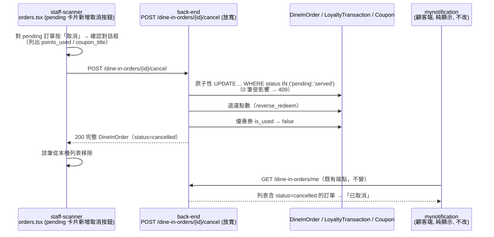

# Plan: 堂食訂單未出餐（pending）也能取消

## Goal
現況（見 `plan-dine-in-order-cancel.md`）：堂食訂單只能 `served → cancelled`，由店員在 staff-scanner 對「已出餐沒付款就走人」的訂單按「作廢」。缺口是 **`pending`（已下單、尚未出餐）訂單沒有任何取消手段**：顧客點錯餐、選錯桌號、店員發現缺料做不出來時，這筆訂單只能繼續留著，結帳時折抵的點數/優惠券也卡住收不回來（訂單根本沒出餐就沒有 `served` 可轉）。

這個 plan 把取消放寬成 **`pending`／`served` 都能 → `cancelled`**，退點數（`reverse_redeem`）、優惠券 `is_used` 回復沿用既有邏輯。觸發者仍是**店員**（staff-scanner），顧客端**這次不開放自己取消**（避免顧客在餐點已在製作時取消；之後要開放需另行討論，例如僅限店員接單前）。

完成的定義：店員在 staff-scanner 的 `pending` 訂單卡片上能按「取消」，確認後訂單轉 `cancelled`、點數/優惠券退還；顧客在 mynotification「我的點餐」看得到「已取消」（**mynotification 這邊不需要改動**，型別、文案、篩選標籤都已在上一份 plan 補齊）。

## Architecture / flow

## Scope

### May modify（mynotification）
- **無程式碼改動。** `types/dineIn.ts` 的 `'cancelled'`、`DINE_IN_ORDER_STATUS_LABEL`、`coupons.tsx` 的「已取消」篩選標籤，上一份 plan 已完成，顧客端對 `pending → cancelled` 與 `served → cancelled` 的顯示完全相同。

### 不在 mynotification 範圍內（已跟兩邊確認可行，2026-09-19）
- **back-end**（約半小時，不需 migration）：
  - `POST /api/v1/dine-in-orders/{id}/cancel` 的狀態判斷從「只允許 `served`」改成「允許 `pending`／`served`」，`completed`／`cancelled` 仍回 409。退款分支（`release_coupon`、`reverse_redeem_points`）本來就不依賴狀態，直接沿用
  - 狀態更新改成原子性條件式 `UPDATE ... WHERE status IN ('pending','served')`，取代現在「先讀狀態再寫」。原因：店員同時按「已收款」和「作廢」時可能出現「已發回饋點數又退點數」的雙重入帳，放寬到 pending 後這個競態窗口更大，要一併處理
  - 409 的 `detail` 文案要改成符合新規則（目前是「只有等待收款的訂單可以標記為取消」，staff-scanner 是直接顯示 `detail`，不改會誤導）
  - 副作用盤點：建立訂單時只有優惠券標記已使用、折抵點數、推播給店員三件事；前兩者取消時已回滾，堂食無庫存，賺點只發生在 `completed`；給店員的舊推播不用回滾（店員列表只撈 pending/served，取消後自然消失）
- **staff-scanner**（約 1 小時內，`orders.tsx` 約 20 行，store 不動）：
  - `pending` 卡片從單顆滿版「用餐完畢」改成並排：次要 danger 樣式（`dangerSurface`）「取消」在左、主要「用餐完畢」在右，各佔一半；沿用現有 `onPressCancelOrder`／`onCancelOrder`／`useOrdersStore.cancelOrder`
  - 確認對話框文案依狀態分支：`pending` →「確定要取消這筆未出餐訂單嗎？已折抵的點數/優惠券會退還」；`served` 維持現有走單「作廢」文案；兩者都照樣列出 `points_used`／`coupon_title`
  - 誤觸風險靠二次確認對話框擋，「用餐完畢」是高頻操作、取消是低頻，不需要額外拉開距離或長按

### Must not modify
- `types/dineIn.ts`、`app/(drawer)/(tabs)/coupons.tsx`、`app/dine-in/order/[id].tsx` — 顧客端顯示邏輯已涵蓋，不需再動
- 不新增顧客自己取消的按鈕/畫面、不新增 `reason` 欄位、不新增顧客推播

## Existing patterns to follow
- 端點與退款邏輯：直接沿用 `plan-dine-in-order-cancel.md` 已上線的 `POST /dine-in-orders/{id}/cancel`，只放寬允許的起始狀態
- staff-scanner 並排按鈕：比照該專案 `served` 卡片現有的「作廢 + 已收款」並排做法

## Constraints
- 觸發者僅限店員；顧客端純顯示結果
- 取消 `pending` 不推播顧客（與 `served` 取消一致，兩邊皆同意）；日後要加可用 `send_user_push_notifications(..., app_id="mynotification")`
- 不做取消原因：要存需要訂單新增 nullable 欄位並三端一起動，屬於可加法、之後補不影響現有行為
- staff-scanner 目前沒有「已取消」清單/篩選/狀態標籤，這次不新增（取消後從列表直接消失，靠顧客端「我的點餐」查詢紀錄）

## Verification
- 端對端（實際觸發在 staff-scanner，需三方協調）：
  1. Happy path：顧客下單並折抵點數 + 使用優惠券（訂單停在 `pending`）→ staff-scanner 對該筆按「取消」並確認 → 該筆從店員列表消失 → mynotification「我的點餐」切「已取消」看得到、狀態文字「已取消」→「紅利點數」出現退點交易 → 「我的優惠券」該張券恢復「待使用」
  2. 錯誤案例：對 `completed`／`cancelled` 訂單呼叫取消回 409，staff-scanner 顯示新版 detail 文案，訂單狀態不變
  3. 競態案例（back-end 本機對正式 DB 驗證）：同一筆 `served` 訂單並發送出「已收款」與「取消」，只有一個成功，不會同時「發回饋點數」又「退點數」
  4. 回歸：`served → cancelled`（走單）行為與上一份 plan 驗證結果一致
- 手動驗證：淺色/深色模式下「我的點餐」列表與詳情頁顯示「已取消」正常（既有畫面，快速確認即可）

## Done definition
- [x] back-end：端點放寬 + 409 文案更新並部署（commit 60d5ab0，2026-09-19 已上線；並發防護實際採 `SELECT ... FOR UPDATE` 鎖列，`/cancel` 與 `PATCH /status` 都加了，效果等同條件式 UPDATE；409 文案為「只有候餐中或等待收款的訂單可以取消」；顧客呼叫回 403）
- [x] staff-scanner：`pending` 卡片新增取消按鈕與分支文案（commit e24b47d，2026-10-12 上線；並排「取消」+「用餐完畢」，共用原 handler，對話框文案依狀態分支，`tsc`/`lint` 乾淨；對 Render production 實測過一次完整流程：訂單 #62，A1 桌，cancel 後狀態變 cancelled 且從 pending 清單消失）
- [x] 使用者實測：pending 取消（訂單 #59，用券+折抵點數）與 served 作廢皆正常（2026-09-19）。過程中發現顧客端「我的」分頁快取不會因店員端取消而刷新（資料其實已退回），已於 coupons.tsx 補上取得焦點即重抓（`useFocusEffect` invalidate `myCoupons`／`my-orders`／`my-dine-in-orders`）
- [x] staff-scanner 按鈕改動已完成並實測（見上，commit e24b47d）；競態案例未另外跑並發測試，但 back-end 已在 `/cancel` 與 `PATCH /status` 都加了 `SELECT ... FOR UPDATE` 鎖列防護，判定風險已緩解
- [x] 三方皆已動工並 commit（back-end `60d5ab0`、staff-scanner `e24b47d`；mynotification 無程式碼改動，本 plan 保留備查）

## Risks & rollback
- 風險：**門市權限檢查缺口**——`/cancel` 與 `PATCH /{id}/status` 目前都沒檢查呼叫者門市是否跟訂單一致，任何門市的店員理論上都能取消別間門市的訂單。放寬到 pending 不會讓這個缺口變大或變小，但值得留意
- 風險：店員誤取消一筆正在製作的訂單，餐點做了卻已退點退券。緩解：二次確認對話框；若實務上常發生，之後再評估「取消需填原因」或「已接單後不可取消」
- Rollback：back-end 把允許狀態改回只有 `served`、staff-scanner 移除 pending 卡片的取消按鈕即可；兩處皆為小範圍改動，不涉及 schema，資料已取消的訂單維持 `cancelled` 無需還原

## Open questions
- **門市權限是否要一併收緊**：back-end 建議維持現狀不在這支單獨加（只加一支會與另外兩支不一致），要收緊應 `/cancel`、`PATCH /{id}/status` 與相關店員端點一起改，是獨立議題，**待使用者決定**是否另開 plan
- **顧客是否應能自己取消 pending 訂單**：這次明確不做，日後若要開放，需先定義「店員接單前」的判斷依據（目前沒有「已接單」狀態）
