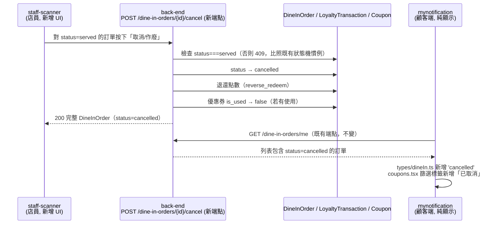

# Plan: 堂食訂單取消/回滾（served 未付款走單）

## Goal
現況：堂食訂單狀態機是 `pending → served → completed`（見 `plan-dine-in-order-payment.md`）。真實情境會發生「顧客已出餐（`served`），但沒付款就直接離開」，目前完全沒有辦法收尾這筆訂單——沒有端點可以把它標記掉，已經折抵的點數/優惠券也永遠卡在「已使用」狀態收不回來。

這個 plan 比照既有網購訂單的 `POST /orders/{id}/cancel`（`services/shop.ts`）邏輯，新增一個**僅限 `served → cancelled`** 的取消端點：退還已折抵的點數（`reverse_redeem`）、優惠券 `is_used` 改回可用。觸發者是**店員**（在 staff-scanner 對走單的訂單按下取消），不是顧客自己取消。

完成的定義（**mynotification 這邊**）：顧客在「我的點餐」看得到被店員取消的訂單，狀態顯示「已取消」，篩選標籤可以篩出來；點進詳情頁不會因為新狀態值而顯示異常或型別錯誤。**mynotification 不新增任何觸發取消的 UI**——已跟使用者確認，取消動作完全由店員在 staff-scanner 端操作，顧客端純顯示結果。

## Architecture / flow

## Scope

### May modify（mynotification）
- `types/dineIn.ts` — `DineInOrderStatus` 新增 `'cancelled'`；`DINE_IN_ORDER_STATUS_LABEL` 新增對應文案（比照 `types/shop.ts` 的 `cancelled: '已取消'`）
- `app/(drawer)/(tabs)/coupons.tsx` — `DINE_IN_FILTER_TABS` 新增 `{ key: 'cancelled', label: '已取消' }`（比照既有 `ORDER_FILTER_TABS` 同名項目）

### Must not modify
- `app/dine-in/order/[id].tsx` — **不需要改**。畫面本來就是用 `DINE_IN_ORDER_STATUS_LABEL[order.status]` 動態渲染，型別補上 `'cancelled'` 後會自動正確顯示；`pointsCard` 沿用既有邏輯（不特別註明「已退還」），比照 `app/order/[id].tsx` 對已取消網購訂單的既有處理方式，維持前端行為一致
- `app/dine-in/{restaurant,table,menu,cart,confirm}.tsx`、`store/useDineInOrderStore.ts` — 這些是「建立新訂單」流程，跟取消已存在訂單無關
- `services/shop.ts`、`types/shop.ts`、網購訂單相關畫面 — 網購走自己獨立的 `cancelOrder`，不共用
- 不新增任何觸發取消的按鈕/畫面（已確認由 staff-scanner 負責）

### 不在 mynotification 範圍內，但需要跨 session 確認的設計（給 back-end/staff-scanner）
- **back-end**：新端點路徑/方法（建議 `POST /api/v1/dine-in-orders/{id}/cancel`，比照 `/orders/{id}/cancel` 命名）、僅允許 `served→cancelled`（其餘狀態回 409）、退點/退券邏輯複用既有 `reverse_redeem`/coupon 恢復機制、要不要限制呼叫者必須是該訂單所屬門市的店員
- **staff-scanner**：在 `orders.tsx` 對 `served` 狀態的訂單卡片加「作廢/取消」按鈕與確認對話框（文案類似「確定要取消這筆訂單嗎？已折抵的點數/優惠券會退還」）

## Existing patterns to follow
- 端點設計/退款邏輯：完全比照 `POST /orders/{id}/cancel`（`services/shop.ts:45`）與其後端實作（`reverse_redeem`、coupon `is_used` 回復）
- 狀態機轉換限制（跳過會 409）：比照 `served`/`completed` 既有轉換規則，見 `plan-dine-in-order-payment.md`
- 前端篩選標籤/型別新增流程：比照 `types/shop.ts` 的 `OrderStatus`+`ORDER_STATUS_LABEL` 新增 `cancelled` 時的既有寫法

## Constraints
- mynotification 端不新增任何 API 呼叫或畫面，純粹是型別/文案補齊
- 不處理「`pending` 訂單取消」——已確認這次範圍僅限 `served → cancelled`

## Verification
- 3 個端對端測試（需要跟 back-end/staff-scanner 三方協調，實際觸發在 staff-scanner 端）：
  1. Happy path：staff-scanner 對一筆 `served` 訂單按下取消 → mynotification「我的點餐」切到「已取消」篩選看到這筆、狀態文字顯示「已取消」→「紅利點數」頁能看到對應的退點交易記錄 → 若該筆用了優惠券，「我的優惠券」該張券恢復成「待使用」
  2. 錯誤案例（back-end/staff-scanner 側）：對 `pending` 或 `completed` 狀態的訂單呼叫取消端點應回 409，staff-scanner 顯示錯誤訊息，訂單狀態不變
  3. 前端型別檢查：`tsc`/`lint` 通過，確認 `DineInOrderStatus` 新增 `'cancelled'` 後所有 `Record<DineInOrderStatus, ...>` 的地方（`DINE_IN_ORDER_STATUS_LABEL`、`DINE_IN_FILTER_TABS` 需求）都有補齊，不會漏掉導致執行期 `undefined` 文案
- 手動驗證：淺色/深色模式下「我的點餐」列表與詳情頁顯示「已取消」狀態正常，沒有排版跑掉

## Done definition
- [x] `types/dineIn.ts`、`coupons.tsx` 改完，`tsc`/`lint` 乾淨
- [x] 已跟 back-end 確認新端點契約（路徑、狀態機限制、退款邏輯）並部署（`POST /api/v1/dine-in-orders/{id}/cancel`，commit `1b71d3d`，已 push main）
- [x] 已跟 staff-scanner 確認觸發 UI 設計並完成實作（`orders.tsx` 的「作廢」按鈕，commit `6ac0dee`，尚未 push——staff-scanner repo 沒設定 remote）
- [x] Happy path 端對端測試通過——staff-scanner 對 Render production 實測過（訂單 id 33，用了「test-dinein」優惠券，cancel 後狀態正確轉 cancelled）
- [ ] mynotification 這邊的改動尚未 commit（等使用者確認 commit 範圍）

## Risks & rollback
- 風險：如果之後業務端又想開放 `pending` 也能取消，這次的窄範圍設計要重新討論狀態機規則，但因為改動極小，重新設計成本低
- 風險：mynotification 這邊改動雖小，但依賴 back-end 端點與資料格式如期到位，型別新增後如果後端還沒回傳 `cancelled` 值，畫面不會出錯（只是永遠不會顯示這個篩選結果），屬於安全的前置改動
- Rollback：`types/dineIn.ts`、`coupons.tsx` 兩處都是新增一個 enum 值/一個陣列項目，`git diff` 還原即可完整回退

## Open questions
- 取消後要不要推播通知顧客？**已確認：這次不做**，顧客下次自己開「我的點餐」才會看到狀態變更
- 該端點是否要限制只有訂單所屬門市的店員能呼叫（比照其他店員限定門市的既有慣例）——留給 back-end/staff-scanner 討論
