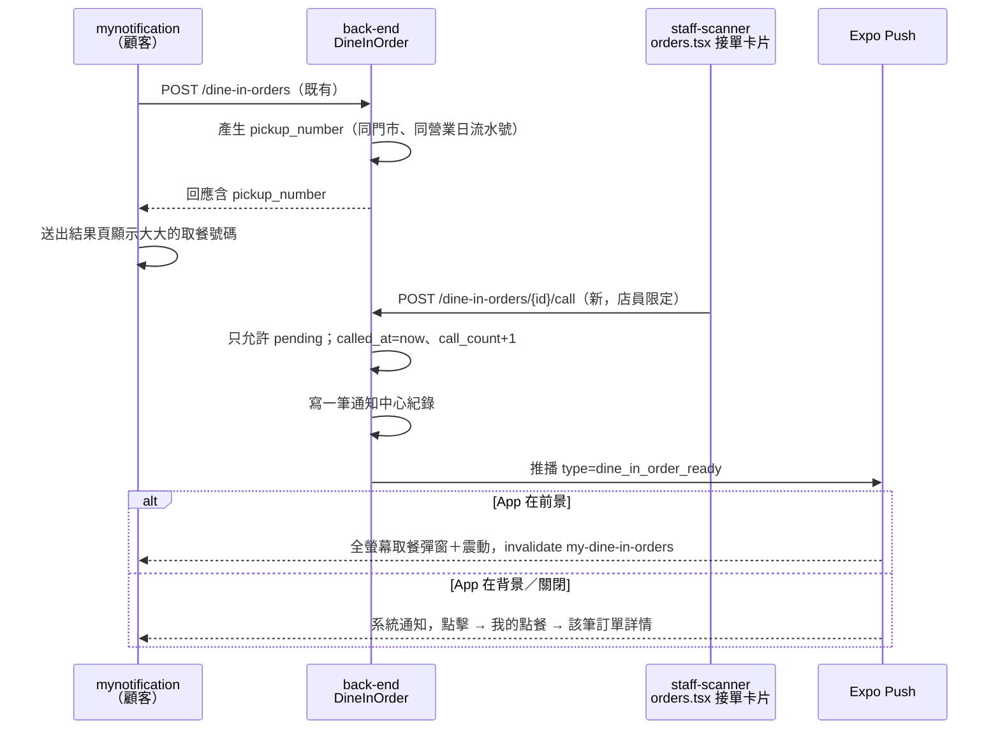

# Plan：堂食取餐叫號推播（Dine-in Pickup Call）

## 目標

堂食顧客用 App 點餐後，現在只能「留意店員出餐」，不知道餐點什麼時候好。改成業界常見的取餐叫號：
**下單時拿到一個取餐號碼（每間門市每天從 1 開始），店員在 `staff-scanner` 按「叫號」，顧客手機就收到「餐點好了，取餐號碼 017」的推播**；顧客剛好開著 App 時跳出全螢幕取餐彈窗並震動，不會錯過。客人沒來可以「再叫一次」。

完成的定義：顧客下單後在送出結果頁與訂單詳情頁看得到自己的取餐號碼；店員按叫號後，App 在背景時收到系統推播、點了進到該筆訂單，App 在前景時跳出全螢幕彈窗＋震動；訂單詳情顯示「已叫號，請取餐」。

### 使用者 2026-11-07 定案的決策

| 題目 | 決定 |
|---|---|
| 怎麼接進訂單流程 | **獨立的「叫號」動作**，不改既有狀態機（`pending → served → completed`／`cancelled`）與點數邏輯；可重複叫號 |
| 號碼 | **每間門市每天從 1 開始的取餐號**，顯示補零成 3 位數（`017`） |
| 前景提示 | **全螢幕取餐彈窗＋震動**，按「我知道了」關閉 |

## 架構／流程



## API 契約（提案，待 back-end 確認）

**`DineInOrder` 新增欄位**（`DineInOrderOut` 一併回傳，既有端點 `POST /dine-in-orders`、`GET /dine-in-orders/me`、店員列表都要帶）

| 欄位 | 型別 | 說明 |
|---|---|---|
| `pickup_number` | int，可空 | 下單時產生，同一門市＋同一營業日（台灣時間）從 1 開始遞增；舊資料為 `null`。並發下單要避免重號（例如 `(restaurant_id, 營業日, pickup_number)` 唯一約束＋重試），做法由 back-end 決定 |
| `called_at` | datetime，可空 | 最後一次叫號時間，沒叫過是 `null` |
| `call_count` | int，預設 0 | 叫號次數 |

**新端點 `POST /api/v1/dine-in-orders/{id}/call`**

- 授權：店員限定（比照 `PATCH /dine-in-orders/{id}/status`），而且只能叫自己門市的單
- 只允許 `status == pending`，其他狀態回 409
- 成功：更新 `called_at`／`call_count`，寫一筆通知中心紀錄，發推播給 `order.user_id` 的所有 push token；回傳更新後的訂單
- 不限制叫號頻率（staff-scanner 按鈕自己做防連點）

**推播內容**

```json
{
  "title": "餐點好了！",
  "body": "取餐號碼 017，請至櫃檯取餐",
  "data": {
    "type": "dine_in_order_ready",
    "screen": "DineInOrder",
    "dine_in_order_id": 123,
    "pickup_number": 17
  }
}
```

## 範圍

### mynotification 可修改
- `types/dineIn.ts`：`DineInOrder` 加 `pickup_number`／`called_at`／`call_count`；新增 `formatPickupNumber()`（補零 3 位）
- `app/dine-in/cart.tsx`：送出成功導去結果頁時多帶 `pickupNumber`
- `app/dine-in/confirm.tsx`：大字顯示取餐號碼，文案改成「餐點完成時會推播通知您」；舊後端沒回號碼時維持原樣
- `app/dine-in/order/[id].tsx`：顯示取餐號碼；`pending` 且 `called_at` 有值時顯示「已叫號，請取餐」標示
- `app/(drawer)/(tabs)/coupons.tsx`：「我的點餐」卡片顯示取餐號碼（有值才顯示）
- `components/PickupCallModal.tsx`（新增）：全螢幕取餐彈窗（大號碼＋「我知道了」＋「查看訂單」）
- `store/usePickupCallStore.ts`（新增）：目前要顯示的叫號（`{ orderId, pickupNumber } | null`），純 UI 狀態，比照 `useNotificationStore`
- `app/(drawer)/(tabs)/_layout.tsx`：前景推播監聽器遇到 `dine_in_order_ready` → invalidate `['my-dine-in-orders']`、震動（`expo-haptics`＋`Vibration`）、打開彈窗，不再另外跳 Toast；並掛上 `PickupCallModal`
- `app/_layout.tsx`：`navigateFromNotificationData` 新增 `screen === "DineInOrder"` → invalidate 後 `router.push('/coupons')` 再 `router.push('/dine-in/order/{id}')`（比照 OrderDetail）
- `app/index.tsx`：`setNotificationHandler` 對 `dine_in_order_ready` 不顯示前景橫幅（已有全螢幕彈窗，避免重複），仍播聲音
- `CLAUDE.md`

### mynotification 不可修改
- 堂食狀態機、點數／優惠券折抵邏輯、其他推播類型的處理方式
- `services/api.ts`、認證相關檔案

## 沿用的既有寫法
- 推播點擊導頁：`app/_layout.tsx` 的 `OrderDetail` 分支（先 push 清單頁再 push 詳情頁，返回鍵才自然）
- 前景推播：`(tabs)/_layout.tsx` 監聽器裡的 `Friends` 分支（依 `screen`／`type` 額外 invalidate）
- 純 UI store：`store/useNotificationStore.ts`

## 限制
- 純 JS，不用重新 `eas build`（`expo-haptics` 已安裝，`Vibration` 是 RN 內建）
- 彈窗顏色走主題色，號碼字級要夠大（遠距離看得到）

## 驗證
1. **正常流程（App 在前景）**：顧客下單 → 結果頁看到取餐號碼 → 店員在 staff-scanner 按叫號 → 顧客手機跳全螢幕彈窗、震動，號碼正確 → 按「查看訂單」進到該筆訂單，顯示「已叫號，請取餐」
2. **App 在背景**：同上，但收到系統通知；點通知進到該筆訂單詳情，返回鍵回到「我的點餐」
3. **再叫一次**：店員再按一次叫號，顧客再收到一次；`call_count` 變 2
4. **錯誤情境**：對已出餐（`served`）的訂單叫號 → 後端 409、staff-scanner 不顯示叫號按鈕
5. **號碼規則**：同一天同一門市連下兩筆，號碼連號；另一間門市從 1 開始；隔天重新從 1 開始（back-end 可用測試資料驗證）
6. `npm run lint`／`tsc` 乾淨

## 完成定義
- [ ] back-end：欄位＋migration、取餐號產生、叫號端點、推播＋通知中心紀錄，部署到 Render
- [ ] staff-scanner：接單卡片顯示取餐號碼與「叫號／再叫一次（已叫 N 次）」按鈕
- [ ] mynotification：上面「可修改」清單完成
- [ ] 驗證 1–4 使用者實機測過
- [ ] CLAUDE.md 更新

## 風險與還原
- 風險：並發下單重號 → 後端用唯一約束＋重試處理
- 風險：舊版 App 收到新推播類型 → 會落到通用處理（Toast＋通知中心），不會壞
- 還原：mynotification 端 revert 即可；後端新欄位可空、新端點獨立，不影響既有流程

## 已確認（2026-11-07 使用者）
- 取餐號碼每天台灣時間 00:00 歸零
