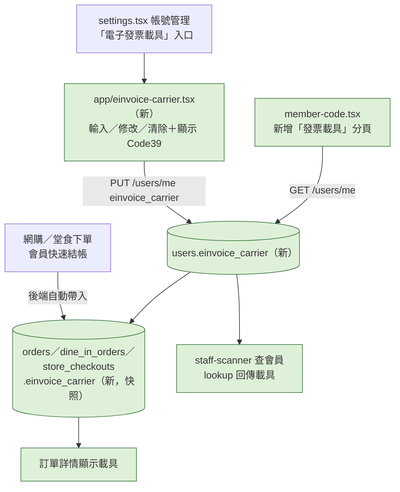

# Plan：電子發票載具（手機條碼）

## 目標

會員在 App 裡綁定自己的財政部手機條碼載具（`/` 開頭共 8 碼），結帳時不用再拿出其他 App：
- 門市結帳時打開「會員條碼」頁的「發票載具」分頁，給店員掃載具條碼
- 網購、堂食、會員快速結帳都會把下單當下的載具記在訂單上，之後串綠界電子發票時可以直接開到載具

完成的定義：設定頁可以新增、修改、清除載具，畫面顯示大大的 Code39 條碼；會員條碼頁多一個「發票載具」分頁；訂單詳情顯示這筆用了哪個載具；店員 App 查會員時看得到載具號碼。

### 使用者 2026-11-09 定案的決策

| 題目 | 決定 |
|---|---|
| 範圍 | **綁定＋出示條碼＋結帳帶入訂單**（這次**不**真正開發票，之後串綠界電子發票另開 plan） |
| 儲存 | **存在後端會員資料**（換手機、重裝都還在，店員 App 也看得到） |
| 驗證 | **只檢查格式**，不向財政部驗證 |

## 規則（提案）

- 格式：`/` 加 7 碼，每碼是 `0-9`、`A-Z`、`.`、`+`、`-`（財政部手機條碼規則），輸入時自動轉大寫、去空白
- 一個會員一組載具，可以改、可以清除
- 訂單記的是**下單當下**的載具（快照）：之後改載具不影響舊訂單
- 條碼格式 **Code39**（財政部手機條碼標準），用既有的 `react-native-barcode-svg`（內含 jsbarcode，支援 CODE39），不用裝新套件、不用重新 build
- 條碼一律白底黑條（比照會員條碼、QR Code 的既有例外，掃描器需要固定高對比，不隨深色模式變色）

## 架構／流程

## API 契約（back-end 2026-11-09 照提案實作，`168f1b5`）

**會員資料**：`GET /api/v1/users/me` 回應加 `einvoice_carrier: string | null`；`PUT /api/v1/users/me` 可帶 `einvoice_carrier`
- 傳字串：後端 normalize（大寫、去空白）後檢查格式，不合回 `400 { error_code: "invalid_einvoice_carrier", message }`
- 傳 `null` 或空字串：清除
- 沒帶這個欄位：不動（既有改暱稱、頭像的呼叫不受影響）

**訂單快照**：`POST /orders`、`POST /dine-in-orders`、`POST /store-checkouts` 建立時，後端自動把該會員當下的 `einvoice_carrier` 複製到訂單上（**前端不用傳**）；三種訂單的回應（含 `/orders/me`、`/dine-in-orders/me`、`/store-checkouts/me`）都加 `einvoice_carrier: string | null`

**店員查會員**：`POST /store-checkouts/lookup` 回應加 `einvoice_carrier: string | null`

## Scope

### May modify（mynotification）
- `app/einvoice-carrier.tsx`（新）— 輸入框＋格式即時檢查、儲存／清除、已綁定時顯示 Code39 條碼與號碼、說明（去哪裡申請手機條碼：財政部電子發票整合服務平台）
- `app/_layout.tsx` — `userToken` 分支註冊 `einvoice-carrier`（header「電子發票載具」）
- `app/(drawer)/(tabs)/settings.tsx` — 「帳號管理」加入口，右側顯示已綁定的號碼或「未設定」
- `app/member-code.tsx` — 「條碼／QR Code」分頁旁加「發票載具」分頁；未綁定時顯示「前往設定」
- `app/order/[id].tsx`、`app/dine-in/order/[id].tsx` — 有載具時顯示「發票載具：/ABC1234」
- `services/users.ts`、`types/`（`einvoice_carrier` 欄位、格式常數、normalize）
- `CLAUDE.md`

### Must not modify
- 結帳流程本身（`cart.tsx`、`dine-in/cart.tsx` 不用傳新欄位）
- 點數、優惠券、會員等級邏輯

### 分工
- **back-end**：`users.einvoice_carrier`、三種訂單的快照欄位、`/users/me` 讀寫與格式檢查、lookup 回傳
- **staff-scanner**：會員快速結帳查到會員時，顯示載具號碼（例如會員卡片上一行「發票載具 /ABC1234」，沒有就不顯示）；結帳成功頁也顯示這筆記到的載具

## 驗證
1. **綁定與出示**：設定 →「電子發票載具」輸入 `/abc1234` → 自動變 `/ABC1234`、儲存成功、顯示條碼；會員條碼頁「發票載具」分頁顯示同一組條碼；用財政部「統一發票兌獎」App 或任何條碼掃描 App 掃得出 `/ABC1234`
2. **格式錯誤**：輸入 `ABC1234`（沒有 /）或 `/ABC12`（太短）→ 儲存按鈕不能按、顯示格式提示；清除後設定頁顯示「未設定」
3. **帶入訂單**：綁定後用會員快速結帳消費一筆 → 店員 App 查會員時看到載具、結帳成功頁顯示載具；之後把載具改掉，舊訂單仍顯示原本的號碼
- 深色模式下條碼仍是白底黑條

## 完成條件
- [x] back-end 部署（`168f1b5`，migration `c46a384d6d33`；刪除帳號時會員載具與三種訂單的載具快照都清空，避免匿名帳號被手機條碼連回本人）
- [x] staff-scanner 顯示載具（`068cd0d`：會員快速結帳會員卡片＋成功頁，使用者追加堂食接單卡片）
- [x] 前端完成，驗證 1～3 實機通過（2026-11-09，前端與 staff-scanner 都測過）
- [x] CLAUDE.md 更新

## 風險與還原
- 風險：只檢查格式，使用者打錯一個字也會存進去，之後開發票會開到別人的載具或開立失敗。處理：畫面上大字顯示號碼請使用者核對；之後真的串綠界電子發票時，再評估用綠界的「手機條碼驗證」API
- 還原：前端拿掉入口與分頁即可；後端欄位都是可空、新增的

## Open questions
- 要不要讓會員在單筆結帳時選「這筆不用載具／改捐贈」？這次不做，等真正開發票時一起設計
- 自然人憑證載具、會員載具（店家自有載具）這次不做
