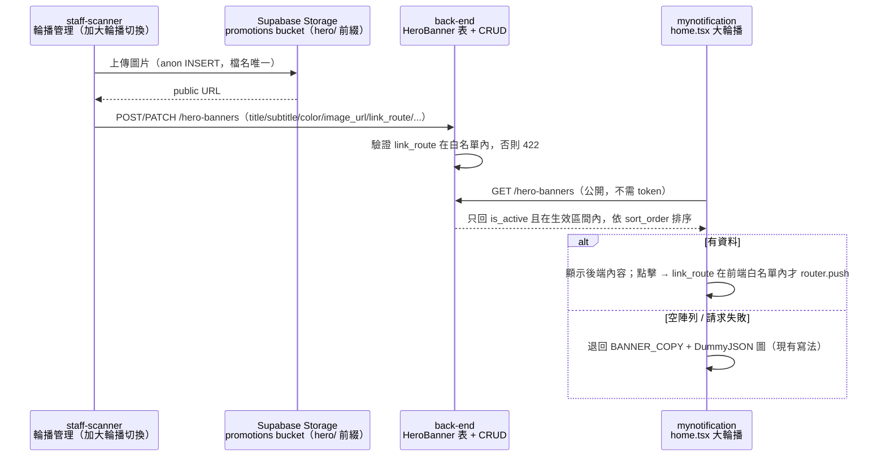

# Plan：首頁大輪播後台化（Hero Banner Admin）

## 目標

首頁「功能 Grid」下方的大輪播（`app/(drawer)/(tabs)/home.tsx` 的 `BANNER_COPY`，4 張橫幅）目前是寫死的前端文案，圖片抓 DummyJSON。改成跟小輪播（`PromoCarousel`，2026-10-16 上線，見 `promo_banner_admin_2026-10-16` 記憶）一樣：**內容由後端資料庫提供，店員在 `staff-scanner` 後台新增/編輯/排序/上下架/設定生效區間/上傳圖片**，改文案不用再改 App、重新上版。

這次比小輪播多一項：每張橫幅可以設定**可選的 App 內導向路徑**，點了跳到指定畫面（例如 `/coupons`、`/points`）。

完成的定義：店員在 `staff-scanner` 改一張大輪播的文案/圖片/導向，顧客端 App 下拉重新整理或重開首頁後就看到新內容，點橫幅會跳到設定的畫面；後端沒有資料或 API 失敗時，首頁仍顯示原本 4 筆寫死的備援文案，版面不會空一塊。

### 使用者 2026-10-28 定案的決策

| 題目 | 決定 |
|---|---|
| 後端空資料／API 失敗 | **保留本機備援**：沿用現在的 `BANNER_COPY` + DummyJSON 圖（比照跑馬燈的 `DEFAULT_MARQUEE_TEXT`） |
| 點擊導向 | **加可選的 App 內路徑**（`link_route`），限定白名單 |
| 圖片存放 | **沿用 Supabase `promotions` bucket**，用檔名前綴 `hero/` 區分，不另開 bucket |
| staff 管理畫面 | **共用現有輪播管理畫面**，上方切換「小輪播／大輪播」 |
| 資料表 | back-end 建議**另開新表**（不在 `Promotion` 加 type 欄位，避免把小輪播的必填欄位改成可空） |

## 架構／流程



## 後端 API 契約（提案，待 back-end 確認）

**新表 `HeroBanner`**

| 欄位 | 型別 | 說明 |
|---|---|---|
| `id` | int PK | |
| `title` | str，必填 | |
| `subtitle` | str，必填 | |
| `color` | str，必填 | 例如 `#EDE7DD`，圖片載入前/失敗時的底色 |
| `image_url` | str，**可空** | 沒圖時只顯示底色＋文字（現有元件本來就這樣處理） |
| `link_route` | str，**可空** | 必須在白名單內（見下方），空值＝點了不動作 |
| `sort_order` | int | |
| `is_active` | bool | |
| `start_at` / `end_at` | datetime，可空 | 比照 `Promotion` |
| `created_at` / `updated_at` | datetime | |

**端點**（路徑由 back-end 決定，以下是建議）

| 方法 | 路徑 | 授權 | 用途 |
|---|---|---|---|
| GET | `/api/v1/hero-banners` | 公開 | 顧客端用，只回上架且在生效區間內的，依 `sort_order` 排序 |
| GET | `/api/v1/hero-banners/admin` | `verify_admin_or_staff` | 後台列出全部（含下架/過期） |
| POST | `/api/v1/hero-banners` | 同上 | 新增 |
| PATCH | `/api/v1/hero-banners/{id}` | 同上 | 部分更新 |
| DELETE | `/api/v1/hero-banners/{id}` | 同上 | 硬刪（比照 `Promotion`） |

公開端點回應：`[{ id, title, subtitle, color, image_url, link_route }]`（snake_case，前端在 service 層轉 camelCase，比照 `services/promotions.ts`）。

**`link_route` 白名單**（三方寫死同一份，比照紅利點數常數的做法；之後要加路徑三邊同步改）：

```
/coupons  /points  /favorites  /inbox  /member-code  /shop  /search  /settings
```

- back-end：不在白名單內回 422
- staff-scanner：用下拉選單選（含「不導向」），不讓店員手打
- mynotification：前端也檢查一次，不在白名單內的值直接忽略（點了不動作），避免後端之後加了新路徑、舊版 App 卻跳到不存在的畫面

**種子資料**：back-end 把現在 `BANNER_COPY` 的 4 筆照原文寫進 DB，`image_url` 填目前 DummyJSON 抓到的那 4 張圖（或留空，之後店員上傳），`link_route` 先全部留空。

## 範圍

### mynotification 可修改
- `services/heroBanners.ts`（新增）：`fetchHeroBanners()`、型別、snake→camel 轉換
- `constants/heroBannerRoutes.ts`（新增）：`link_route` 白名單常數
- `app/(drawer)/(tabs)/home.tsx`：
  - 大輪播改用 `useQuery({ queryKey: ['hero-banners'] })`
  - 空陣列或錯誤時退回 `BANNER_COPY` + `fetchBannerImages()`（備援時才抓 DummyJSON 圖）
  - 每張 slide 包 `Pressable`，`linkRoute` 在白名單內才 `router.push`
  - 下拉重新整理時順便 refetch `['hero-banners']` 與 `['promo-banners']`（使用者已確認）
- `CLAUDE.md`：首頁大輪播說明、後端 API 路由表

### mynotification 不可修改
- 小輪播（`PromoCarousel`、`services/promotions.ts`）的行為與契約
- `services/api.ts`、`app/_layout.tsx`、認證相關檔案
- 其他 repo 的檔案（back-end／staff-scanner 由各自 session 實作）

## 沿用的既有寫法
- `services/promotions.ts`：公開端點 + 型別轉換
- `home.tsx` 的 `Marquee`：後端空資料/失敗時用本機備援的判斷方式
- `home.tsx` 的 `QuickActionsGrid`：`router.push` 的寫法（不含路由群組前綴）

## 限制
- 不新增第三方套件，不需要重新 `eas build`（純 JS 改動，Fast Refresh 就能測）
- 大輪播配色維持寫死、不隨深色模式切換（既有設計決策，見 CLAUDE.md「刻意不套用主題色」）

## 驗證

1. **正常流程**：staff-scanner 新增一張大輪播（上傳圖、設 `link_route=/points`、排第一）→ 顧客端下拉重新整理 → 首頁大輪播第一張是新內容，點它跳到「紅利點數」畫面
2. **空資料備援**：staff-scanner 把所有大輪播下架 → 顧客端重新整理 → 首頁顯示原本 4 筆寫死文案＋DummyJSON 圖，不是空白
3. **白名單**：用 Postman 帶不在白名單的 `link_route`（例如 `/admin`）呼叫 POST → 後端回 422；沒設 `link_route` 的橫幅點了不會跳頁也不報錯
4. 補充：設定 `end_at` 為過去時間的橫幅不出現在顧客端；`npm run lint` 與 `tsc` 乾淨

## 完成定義
- [ ] back-end 部署新表＋CRUD＋種子資料
- [ ] staff-scanner 輪播管理畫面可切換大輪播並完成 CRUD＋圖片上傳
- [ ] mynotification 大輪播改讀後端、備援與點擊導向正常
- [ ] 上面 3 個驗證項目使用者實機測過
- [ ] CLAUDE.md 更新

## 風險與還原
- 風險：後端欄位名或路徑跟提案不同 → 以 back-end 回覆的定案為準，再改 service 層
- 風險：舊圖檔殘留在 bucket（換圖/刪除不清舊檔）→ 跟小輪播一樣先接受
- 還原：mynotification 端 revert `home.tsx` 就回到寫死版本，後端表留著不影響

## 已確認（2026-10-28 使用者）
- 白名單 8 個路徑照提案
- 下拉重新整理時一起 refetch `['hero-banners']` 與 `['promo-banners']`
- 實際 API 路徑命名交給 back-end 決定，前端以其回覆為準
