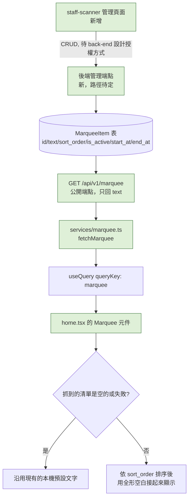

# Plan: 跑馬燈內容改成後台可維護

## Goal
首頁跑馬燈目前是 `app/(drawer)/(tabs)/home.tsx` 裡一個寫死的字串常數（`MARQUEE_TEXT`），要換內容只能改程式碼、重新發版。使用者希望改成存在資料庫，不用出 App 版本就能換內容，**並且要有後台管理畫面可以編輯**（2026-10-13 定案：管理畫面放在 `staff-scanner`，不是另開新工具，也不是塞進 mynotification）。

範圍刻意只限跑馬燈（已跟使用者確認）：首頁大輪播（`BANNER_COPY`）、小輪播（`PromoCarousel` 的 `PROMO_COPY`）這次**不動**，維持現有的前端假資料，之後如果要做留給獨立的 plan。

完成的定義：後端有一張表存跑馬燈的多筆文字內容；mynotification 打公開端點抓取並顯示；`staff-scanner` 有一個管理頁面，店員登入後能新增/編輯/上下架跑馬燈內容。

## Architecture / flow

## Scope

### May modify（mynotification）
- `services/marquee.ts`（新）— `fetchMarquee(): Promise<MarqueeItem[]>`，呼叫 `GET /api/v1/marquee`
- `types/marquee.ts`（新，或視欄位簡單程度直接寫在 service 檔案裡）— `MarqueeItem { text }`（公開端點只回 `text`，不需要 `id`/`sort_order` 給前端，後端已排序好）
- `app/(drawer)/(tabs)/home.tsx` 的 `Marquee` 元件：
  - 新增 `useQuery({ queryKey: ['marquee'], queryFn: fetchMarquee })`
  - 把現有的 `MARQUEE_TEXT` 常數改名成 `DEFAULT_MARQUEE_TEXT`，當作**後端清單為空或請求失敗時的本機備援內容**（避免後端還沒建資料，或網路異常時跑馬燈整個消失、版面空一塊）
  - 顯示內容：後端回傳的清單已經是排序好、只含上架中文字，直接用全形空白接起來（沿用現有 `DEFAULT_MARQUEE_TEXT` 本身的接法）

### 不在 mynotification 範圍內（back-end + staff-scanner）

**back-end**（2026-10-13 已評估可行，細節已定案，尚未排入開發）：
- 新 model `MarqueeItem`：`id`／`text`／`sort_order`／`is_active`／`start_at`／`end_at`／`created_at`——**`start_at`/`end_at` 確定要加**（back-end 評估：`Promotion` 已有同一組欄位且查詢條件已經在用 `is_active=True AND (start_at IS NULL OR start_at<=now) AND (end_at IS NULL OR end_at>=now)`，直接比照同一套查詢，成本接近零，現在不加之後要補是一次 migration+改查詢，不如一次做好）
- 公開端點 `GET /api/v1/marquee`：`MarqueeItemOut` 只回 `text`，依 `sort_order` 排序、只回符合上面那組上架條件的資料
- **文字長度不加資料庫層限制**（back-end 決定）：維持跟 `SearchSuggestion.keyword`／`Promotion.title` 一致（不限長度的 `String`，無 `VARCHAR(n)`/`CHECK`）。理由：這次沒有對應的 create 端點可以掛 Pydantic `max_length` 驗證（資料庫層加限制在「直接維護」情境下只會在手動塞資料時噴不好懂的 DB 錯誤，擋不到什麼），改用註解寫清楚建議長度給維護者看
- 工作量很小（model+migration+schema+端點，比照 `SearchSuggestion` 規模，約 20-30 分鐘）

**back-end 管理端點**（2026-10-13 已定案，尚未排入開發）：
- `GET /api/v1/marquee/admin`——列出全部（含未上架、含已過期時間區間的），依 `sort_order` 排序。路由要註冊在任何 `GET /marquee/{id}`（如果之後加的話）之前，避免 `"admin"` 被吃掉當成 `{id}` 變 422（`Product` 已踩過的坑）
- `POST /api/v1/marquee`——新增，`MarqueeItemCreate`：`text` 必填，`sort_order`/`is_active`/`start_at`/`end_at` 皆可選有預設值
- `PATCH /api/v1/marquee/{id}`——`MarqueeItemUpdate` 全欄位 Optional，絕對覆蓋（沒有相對增減的需求）
- `DELETE /api/v1/marquee/{id}`——**真的硬刪除**（不像 `Product`/`MenuItem` 只能軟刪，因為沒有任何表的外鍵參照 `MarqueeItem.id`，不會動到歷史訂單完整性）；`PATCH {"is_active": false}` 仍可用於「暫時下架但保留」，兩種操作並存
- Model 新增 `updated_at`（`onupdate=func.now()`，跟 `Product`/`MenuItem` 一致，因為這批有 PATCH 需要看出最後編輯時間）
- **授權：`verify_admin_or_staff` 雙軌**（`X-Admin-Key` 或 `role="staff"` JWT 皆可，比照 `Restaurant` CRUD 而非 `Product` CRUD——back-end 判斷跑馬燈文案屬於品牌/行銷決策，性質更接近「改門市資訊」而非「改商品庫存」這種日常操作）。這個依賴已存在（`app/api/deps.py`），不需額外開發
- 工作量約 1 小時（含驗證跟文件）

**staff-scanner 管理頁面**（2026-10-13 已定案，尚未排入開發）：
- 入口：**首頁 tab 新增一顆按鈕**（首頁目前只有歡迎詞跟登出）
- UI：比照既有 `products.tsx`/`menu-items.tsx` 的「清單 + 點一下展開內嵌編輯面板」寫法——文字輸入框、上下架 `Switch`、起訖時間輸入（需要新增 date/time picker 套件，這個專案目前沒用過，是唯一的新依賴）、排序用數字 `sort_order` 輸入框或上下移按鈕（不做拖拉排序，避免為此單一功能引入拖拉手勢套件）
- 工作量約半天到一天（含 lint/tsc 跟對 Render 實測）
- **授權**：呼叫上面那組 `verify_admin_or_staff` 端點時帶現有的 `role="staff"` JWT 即可通過（雙軌其中一軌），不需要額外改造 staff-scanner 本身的登入機制

### Must not modify
- `BANNER_COPY`（首頁大輪播文案）、`PROMO_COPY`（`PromoCarousel` 小輪播文案）——這次範圍明確排除，維持現有前端假資料
- `Marquee` 元件本身的跑動動畫邏輯（`withRepeat`/`withTiming` 那段）——只改資料來源，顯示機制不動

## Existing patterns to follow
- 資料抓取＋`useQuery`：比照 `home.tsx` 現有的 `fetchCategories`／`fetchProducts` 寫法（獨立 fetch 函式 + queryKey）
- 上架條件查詢：比照 `Promotion`／`GET /promotions/home-banners` 既有的 `is_active`+`start_at`/`end_at` 查詢邏輯
- 管理端點授權：**待討論**，可能的參考對象是 `POST /coupons/admin/issue` 的雙軌授權（`X-Admin-Key` 或 `role=staff`），或單純 `role=staff` 即可（見 Open questions）

## Constraints
- 這是純展示性內容，不影響任何交易/金流邏輯，請求失敗時的容錯（退回本機預設文字）比精確到位更重要
- 文字長度沒有強制限制，只能靠管理畫面的 UI 提示（例如字數顯示）或維護者自律，不會被後端擋下

## Verification
- 3 個端對端測試（mynotification 端，消費公開端點）：
  1. Happy path：後端資料庫有 2～3 筆上架中的跑馬燈內容，App 首頁顯示的跑馬燈文字跟後端資料一致、順序正確
  2. 錯誤案例：後端這張表目前是空的（或 API 回傳空陣列），App 首頁跑馬燈顯示本機預設文字，不會整塊消失或顯示空白
  3. 錯誤案例：API 呼叫失敗（例如暫時斷網），App 首頁跑馬燈一樣顯示本機預設文字，不會整個畫面卡住或報錯
- 另外需要 staff-scanner 端的測試（待該 session 設計完管理頁面後補）：店員登入後能新增/編輯/上下架跑馬燈項目，存檔後 mynotification 那邊能看到變化
- 手動驗證：後端新增一筆跑馬燈內容後，App 下拉重新整理或重開 App 能看到新內容（跑馬燈目前沒有下拉重新整理的 UI，確認方式待討論，見 Open questions）

## Done definition
- [x] 已跟 back-end 確認公開端點契約＋管理端點契約並部署（commit `59dcb97`，2026-10-13，本機對正式 DB 端對端驗證過：公開端點正確濾掉下架/未生效/已過期項目、雙軌授權兩條路都能通過、一般顧客 JWT 正確被拒 401、PATCH 上下架生效、DELETE 硬刪除、找不到 id 回 404）
- [x] 已跟 staff-scanner 確認管理頁面設計並完成（commit `0eadb5e`，尚未 push——該 repo 沒設 remote；對照過 back-end 原始碼確認契約一致；`start_at`/`end_at` 改用純文字輸入，沒有新增 date/time picker 套件——因為發現 mynotification 其實是用自製的 `BirthdayPicker.tsx` 而非 `@react-native-community/datetimepicker`，原本「跟你們一致」的理由不成立；DELETE 硬刪除多做了二次確認對話框；已對 Render production 跑過完整 CRUD 驗證）
- [x] `services/marquee.ts`、`home.tsx` 的 `Marquee` 元件改完，`tsc`/`lint` 乾淨
- [ ] mynotification 端 3 個測試都通過
- [ ] staff-scanner 管理頁面測試通過（新增/編輯/上下架能正確反映到 mynotification）
- [ ] Commit（三方各自）

## Risks & rollback
- 風險：首頁目前沒有「下拉重新整理」的全域機制，`['marquee']` 這個 query 預設有全域 5 分鐘 staleTime，後端剛換內容不會馬上反映，使用者要等快取過期或重開 App 才看得到——這跟其他展示性內容（例如大輪播）的既有體驗一致，這次不特別處理
- 風險：授權方式過程中有一段決策反覆——使用者先選簡單的單一 `role=staff`，看到 back-end 比照 `Restaurant`（雙軌）的理由後改選雙軌，但同時間 staff-scanner 那邊的使用者（看過同一份風險說明）選了單一 `role=staff`。**最終以 mynotification 使用者的決定為準：`verify_admin_or_staff` 雙軌**，已請 staff-scanner 配合調整。這代表任何門市的 `role=staff` 帳號仍然能管理這個全站共用內容（雙軌是「多一種方式也能通過」，不是「限制只有特定人能用」），如果之後想真正限制「只有特定人」，需要額外的角色或白名單設計，這次沒有做到這麼嚴格
- Rollback：mynotification 端純新增 service／型別檔案 + `Marquee` 元件內部小改動，`git diff` 還原即可，不影響其他畫面

## Open questions
- 全部已確認（2026-10-13）：管理端點授權採 `verify_admin_or_staff` 雙軌；staff-scanner 管理頁面入口放在首頁 tab 新增按鈕；UI 設計比照既有 `products.tsx`/`menu-items.tsx` 模式
- 跑馬燈目前沒有下拉重新整理機制，使用者編輯後 mynotification 端要多久才看得到新內容（目前預期是重開 App 或等 5 分鐘快取過期），這個體感是否可以接受——尚未實際驗證，留到測試階段確認

## 待解決：手刻 Marquee 的既有排版缺陷（2026-10-13 發現，尚未修好，下一個 session 接手）

**現象**：後端兩筆資料接起來後文字變長（例如「歡迎光臨！新會員註冊享首購優惠　全館消費滿額即可折抵紅利點數，立即體驗！」），`app/(drawer)/(tabs)/home.tsx` 的 `Marquee` 元件會把超出某個寬度的部分截斷成「...」，拿掉 `numberOfLines` 後則變成自動換行成兩行。原本寫死的單句短文字剛好沒碰到這個上限，所以這是一個**既有的排版缺陷**，不是這次新增的 bug，只是這次才被更長的真實內容觸發出來。

**已經試過、確認無效的做法**（下一個 session 不要重複嘗試）：
1. 在 `marqueeTrack`／`marqueeText` 加 `flexShrink: 0`——無效，因為 `marqueeTextClip` 沒設定 `flexDirection`（預設 `column`），主軸是直向，`flexShrink` 管的是主軸尺寸（高度），完全沒管到寬度
2. 在 `marqueeTrack` 加 `alignSelf: 'flex-start'`（想跳脫 column 父層預設 `alignItems:'stretch'` 把子層橫向拉滿）——無效，結果完全沒變化
3. 用一個 `position: 'absolute'` 的隱藏 `Text` 量測文字自然寬度，再給 `marqueeTrack`／`Text` 套用量到的明確數字寬度——無效，懷疑連這個「絕對定位」量測本身都還是被外層容器寬度夾住（CSS/Yoga 的 shrink-to-fit 演算法對絕對定位元素預設還是會用最近容器寬度當上限），導致量到的數字本身就是錯的
4. 改用 `ScrollView`（`scrollEnabled={false}`）取代 `View + overflow:hidden` 當作裁切容器——**會直接讓畫面 crash**：噴出 `ScrollView child layout must be applied through the contentContainerStyle Prop` render error，原因是排版用的 `flexDirection` 直接放在 `ScrollView` 的直接子層（`Animated.View`）上；改成讓 `Animated.View` 只放 `transform`、另外包一層普通 `View` 放 `flexDirection` 後，這個特定錯誤不再出現，但**使用者回報「相同 Error」仍然發生**（細節當下沒來得及進一步追問就先收工，下一個 session 開始要先跟使用者確認清楚這次的錯誤訊息文字跟 stack trace 是否真的完全一樣，還是外觀像但其實是別的錯誤）

**目前狀態**：已退回最原始寫法（`View + overflow:hidden + numberOfLines={1}`），確認 `tsc`/`lint` 乾淨、App 不會 crash，但維持「文字過長會截斷成...」的瑕疵。資料串接的部分（`services/marquee.ts`、`useQuery` 串接、`DEFAULT_MARQUEE_TEXT` 備援邏輯）都正常運作、沒有問題，只有這個手刻 Marquee 元件本身的排版機制有缺陷。

**下一個 session 建議的新方向**（都還沒試過）：
- 先截圖/完整複製第 4 次嘗試（ScrollView 版本）實際噴出的錯誤文字與 stack trace，確認是不是同一個 `ScrollView child layout` 錯誤換了個地方冒出來（例如 `Animated.View` 本身被 Reanimated 在底層又做了什麼處理，導致 `transform` 以外的東西還是被當成直接子層樣式）
- 考慮完全不用「兩份文字接龍 + translateX 位移動畫」這種手刻機制，改用現成、已經被社群驗證過的跑馬燈套件（例如 `react-native-marquee`、`react-native-text-ticker` 這類），不用自己跟 Yoga 排版引擎的邊界行為奮戰
- 或者考慮完全不同的視覺呈現方式（例如固定顯示一句、每隔幾秒淡入淡出切換到下一句，不做橫向捲動），繞過這整個「文字寬度超出可視範圍」的技術難題——這個要跟使用者確認是否能接受改變原本的視覺效果
