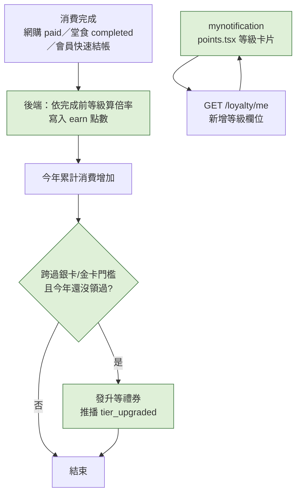

# Plan：會員等級（Member Tier）

## 目標

在既有的紅利點數制度上加會員等級：依**自然年度**累計消費分成一般會員／銀卡／金卡，等級越高點數回饋越多，升等時送禮券，生日禮券也依等級加碼。讓會員有「再消費一點就升等」的動機。

完成的定義：「紅利點數」畫面上方顯示目前等級、今年累計消費、距離下一級還差多少（進度條）、等級效期與權益；消費完成後點數依等級倍率入帳；跨過門檻時自動升等、發升等禮券並推播；設定頁與會員條碼頁看得到等級。

### 使用者 2026-11-07 定案的決策

| 題目 | 決定 |
|---|---|
| 等級與門檻 | **一般會員**（NT$0）／**銀卡**（NT$10,000）／**金卡**（NT$30,000） |
| 累計方式 | **自然年度制**（台灣時間 1/1～12/31） |
| 計入範圍 | **跟賺點數一樣**：已付款的網購訂單、已完成的堂食、會員快速結帳；取消不算；用折抵後的實付金額 |
| 等級權益 | **點數回饋加倍**、**升等禮券**、**生日禮券依等級加碼** |

## 等級規則（提案，請使用者確認數字）

### 等級怎麼算（不需要年底結算排程）
```
今年等級 = max( 依「去年」全年消費換算的等級 , 依「今年至今」消費換算的等級 )
```
- 今年消費一跨過門檻就**立即升等**，有效到**明年 12/31**
- 只靠去年消費維持的等級，有效到**今年 12/31**；跨年後若今年消費不足就自然降一級（或降回一般）
- 後端每次查詢即時計算，不用存等級欄位、不用跑年底排程（若 back-end 為了效能想快取也可以）

### 權益數字（提案）

| | 一般會員 | 銀卡 | 金卡 |
|---|---|---|---|
| 年度消費門檻 | NT$0 | NT$10,000 | NT$30,000 |
| 點數回饋 | 每 NT$100 得 1 點（1 倍） | 1.5 倍 | 2 倍 |
| 升等禮券 | — | $100（30 天效期） | $200（30 天效期） |
| 生日禮券 | $100（基礎金額） | $200 | $300 |

- 點數計算：`floor(實付金額 ÷ 100 × 倍率)`，倍率用**這筆消費完成前**的等級（這筆讓你升等，下一筆才享新倍率）
- 升等禮券：每個等級**每年度最多發一次**（避免降等再升等重複領）；一次跨兩級（直接到金卡）只發金卡那張
- 點數明細的 `reason` 標示倍率，例如「堂食消費回饋（金卡 2 倍）」

## 架構／流程



## API 契約（提案，待 back-end 確認）

**擴充 `GET /api/v1/loyalty/me`**（向下相容，只加欄位）

```json
{
  "balance": 1234,
  "tier": "silver",
  "year_spend": 12500,
  "next_tier": "gold",
  "amount_to_next_tier": 17500,
  "tier_expires_at": "2027-12-31",
  "earn_multiplier": 1.5
}
```
- `tier`：`"regular" | "silver" | "gold"`
- `year_spend`：今年（台灣時間）累計實付消費
- `next_tier`／`amount_to_next_tier`：已是金卡時都是 `null`
- `tier_expires_at`：目前等級的有效期限（一般會員為 `null`）

**升等推播**：沿用既有的優惠券推播格式，點了直接打開升等禮券
```json
{
  "title": "恭喜升等金卡！",
  "body": "送您一張 $200 升等禮券，之後消費點數 2 倍回饋",
  "data": { "type": "tier_upgraded", "screen": "Coupons", "coupon_id": 456, "tier": "gold" }
}
```

## 範圍

### mynotification 可修改
- `constants/loyalty.ts`：等級常數（`MEMBER_TIERS`：key、中文名稱、門檻、倍率、徽章顏色），比照既有「比例寫死在雙邊」的慣例
- `types/loyalty.ts`：`MemberTier` 型別、`LoyaltyMe` 回應型別
- `services/loyalty.ts`：新增 `fetchLoyaltyMe()` 回傳完整物件；既有 `fetchLoyaltyBalance()` 維持不變（其他畫面在用）
- `app/points.tsx`：上方新增等級卡片（等級徽章、今年累計、進度條「再消費 NT$X 升級金卡」、效期、三個等級權益對照）
- `app/(drawer)/(tabs)/settings.tsx`：「紅利點數」那列的徽章顯示等級＋點數（例如「銀卡・1,234 點」）
- `app/member-code.tsx`：會員條碼上方顯示等級徽章
- `app/_layout.tsx`：`Coupons` 推播分支在 `type === 'tier_upgraded'` 時多 invalidate 點數相關快取
- `CLAUDE.md`

### 需要其他 session 做的
- **back-end**：等級計算、點數倍率、升等禮券（含每年度每級一次的紀錄）、生日禮券加碼、`/loyalty/me` 擴充、升等推播
- **staff-scanner**（小）：會員快速結帳查到會員時顯示等級徽章（店員知道是金卡客人），非必要

### mynotification 不可修改
- 點數折抵規則（1 點＝NT$1、單筆最高 50%）、既有點數明細的 5 種 type

## 限制
- 純 JS，不用重新 `eas build`
- 等級徽章顏色是「會員卡」的品牌色（銀、金），比照輪播粉彩色系視為內容色、不隨深淺色主題切換

## 驗證
1. **升等**：用測試帳號累計消費跨過 NT$10,000（back-end 可用測試資料或店員 App 的會員快速結帳打一筆大金額）→ 收到升等推播、點開是 $100 禮券；點數畫面顯示銀卡、效期到明年 12/31
2. **倍率**：銀卡狀態下再消費 NT$1,000 → 入帳 15 點，明細寫「1.5 倍」
3. **不重複發券**：同一年度再次跨過銀卡門檻（例如取消訂單後又消費）→ 不再發銀卡禮券
4. **進度條**：一般會員消費 NT$3,000 → 顯示「再消費 NT$7,000 升級銀卡」
5. **跨年**（back-end 用測試資料驗證）：只有去年消費達銀卡、今年沒消費 → 今年仍是銀卡、效期今年 12/31
6. `npm run lint`／`tsc` 乾淨

## 完成定義
- [x] back-end 部署等級計算、倍率、升等禮券、生日加碼、`/loyalty/me` 擴充（`49e7ad8`）
- [x] mynotification 上面「可修改」清單完成（`79ee36b`）
- [x] staff-scanner 會員快速結帳顯示等級（2026-11-08 完成，待 staff 那邊 commit）
- [x] 驗證 1、2、4 使用者實機測過（2026-11-08：進度條、升等推播＋禮券、1.5 倍入帳、設定頁徽章都 OK）
- [x] CLAUDE.md 更新

## 風險與還原
- 風險：網購金流仍是測試環境，網購消費目前只有測試卡能讓訂單變 `paid`；等級主要靠堂食與會員快速結帳累計
- 風險：倍率造成點數發放變多 → 數字寫在常數，要調整改常數即可
- 還原：前端 revert 即可；`/loyalty/me` 只加欄位，舊版 App 不受影響

## 已確認（2026-11-07 使用者）
- 權益數字照提案（倍率 1／1.5／2、升等禮券 $100／$200、生日禮券 ×1／×2／×3）
- 生日禮券基礎金額 NT$100（back-end 2026-11-07 回報）：一般 $100／銀卡 $200／金卡 $300，等級以發券當天（每月 25 日）計算
