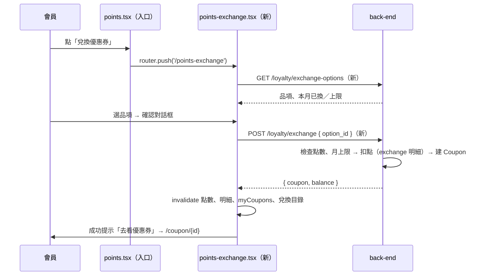

# Plan：點數兌換優惠券（Points Exchange）

## 目標

會員可以用紅利點數換優惠券。現在點數只能在結帳時 1 點折抵 NT$1，換券要比直接折抵划算，鼓勵會員存點數、回來消費。

完成的定義：「紅利點數」畫面有「兌換優惠券」入口，列出可兌換的券（所需點數、面額、本月還能換幾張）；按兌換並確認後扣點、發一張 30 天效期的優惠券，馬上出現在「我的優惠券」；點數明細多一筆「兌換優惠券」紀錄。點數不足或本月已達上限時不能換，畫面說明原因。

### 使用者 2026-11-07 定案的決策

| 題目 | 決定 |
|---|---|
| 兌換目錄 | **寫死在後端**（之後要後台管理再另外做） |
| 兌換比例 | **換券比較划算**，面額越大越划算 |
| 券效期 | **30 天**（同歡迎禮券、升等禮券） |
| 退回 | **兌換後不能退回點數**，券過期沒用就沒了 |
| 次數上限 | **每人每月有上限** |

## 兌換規則（提案，請使用者確認數字）

| 品項 | 所需點數 | 優惠券面額 | 等於 1 點值 |
|---|---|---|---|
| $100 折價券 | 90 點 | $100 | NT$1.11 |
| $300 折價券 | 250 點 | $300 | NT$1.20 |
| $500 折價券 | 400 點 | $500 | NT$1.25 |

- 每人每月（台灣時間自然月）最多兌換 **3 張**，三種品項合計
- 換到的券跟其他優惠券一樣：網購、堂食、門市結帳都能用，不限門市
- 扣點順序沿用既有折抵邏輯（先扣最早到期的那批點數）

## 架構／流程



## API 契約（back-end 2026-11-08 已確認，照提案實作）

**`GET /api/v1/loyalty/exchange-options`**（需登入）

```json
{
  "options": [
    { "id": "coupon_100", "title": "$100 折價券", "points_cost": 90, "discount_amount": 100, "valid_days": 30 },
    { "id": "coupon_300", "title": "$300 折價券", "points_cost": 250, "discount_amount": 300, "valid_days": 30 },
    { "id": "coupon_500", "title": "$500 折價券", "points_cost": 400, "discount_amount": 500, "valid_days": 30 }
  ],
  "monthly_limit": 3,
  "used_this_month": 1
}
```

**`POST /api/v1/loyalty/exchange`**（需登入），body `{ "option_id": "coupon_100" }`

- 成功 `201`：`{ "coupon": <Coupon 物件，同 /coupons/me 的格式>, "balance": 1144 }`
- 點數不足：`409 { "error_code": "insufficient_points", "message": "..." }`（沿用結帳折抵的錯誤碼）
- 本月已達上限：`409 { "error_code": "exchange_limit_reached", "message": "..." }`
- 不認得的 `option_id`：`404`
- 錯誤格式比照「紅利點數」的規則：`detail` 是帶 `error_code` 的物件

**點數明細新增 type `exchange`**（固定負向），`reason` 例如「兌換 $100 折價券」；`LoyaltyTransaction` 加可選欄位 `related_coupon_id`。

## Scope

### May modify（mynotification）
- `app/points-exchange.tsx`（新）— 兌換畫面
- `app/_layout.tsx` — 在 `userToken` 分支註冊 `points-exchange`（header title「兌換優惠券」）
- `app/points.tsx` — 餘額卡片加「兌換優惠券」按鈕；`TX_DISPLAY` 加 `exchange`；**遇到不認得的 type 用通用樣式，不閃退**
- `services/loyalty.ts` — `fetchExchangeOptions()`、`exchangePoints(optionId)`
- `types/loyalty.ts` — `exchange` type、標籤、`related_coupon_id`、兌換目錄型別
- `CLAUDE.md` — 紅利點數章節、API 路由表

### Must not modify
- 結帳折抵（`app/cart.tsx`、`app/dine-in/cart.tsx`）、優惠券核銷流程（`app/coupon/[id].tsx`）
- `services/api.ts`、`store/useAuthStore.ts`
- `constants/loyalty.ts` 的既有比例常數（兌換目錄以後端回傳為準，前端不寫死）

### 分工
- **back-end**：兌換目錄常數、兩支 API、`exchange` 明細與月上限計算、扣點（同一個 transaction 內扣點＋建券，避免扣了點沒拿到券）
- **staff-scanner**：不用改（換到的券跟一般券一樣核銷）

## 既有寫法沿用
- 畫面結構、樣式比照 `app/points.tsx`（`useThemeColors` + `createStyles`）
- 錯誤分流比照 `app/cart.tsx` 的 `error_code` 判斷
- 成功後的快取刷新：`['loyalty-balance']`（會連帶刷新等級）、`['loyalty-transactions']`、`['myCoupons']`、`['loyalty-exchange-options']`

## 驗證
1. **正常兌換**：有 100 點以上的帳號換 $100 券 → 餘額少 90、明細多一筆「兌換 $100 折價券 -90 點」、「我的優惠券」出現 30 天效期的 $100 券，結帳能用
2. **點數不足**：點數少於所需的品項顯示「點數不足」且不能按；用舊快取硬送時，後端回 409，畫面顯示「點數不足」，點數不變
3. **月上限**：同月換第 4 張 → 按鈕停用並顯示「本月已兌換 3／3 張」；後端回 `exchange_limit_reached` 時也正確提示
- 手動檢查：深淺色模式都正常；連按兩下「確認」不會換兩張（送出中停用按鈕）

## 完成條件
- [x] back-end 部署兩支 API 與 `exchange` 明細（`e859ef8`，migration `72fa08909b6d`）
- [x] 前端完成，以上 3 項實機驗證通過（2026-11-08；實測後把「本月可兌換 剩餘／上限」改成「本月已兌換 已換／上限」，避免誤讀）
- [x] CLAUDE.md 更新
- [x] 沒有改到 Must not modify 的檔案

## 風險與還原
- 風險：舊版 App 的點數明細遇到新的 `exchange` type 會找不到 `TX_DISPLAY` 而閃退。處理：這次前端加通用樣式；已發出去的舊 Preview 版要提醒使用者更新
- 風險：連點造成重複兌換。處理：前端送出中停用按鈕；後端在同一個 transaction 內重新檢查點數與上限
- 還原：前端移除入口即可；後端兩支 API 是新增的，不影響既有功能

## Open questions
- ~~兌換品項與點數、每月上限~~ → 使用者 2026-11-07 確認：90／250／400 點、每月 3 張
- ~~type 名稱~~ → back-end 確認用新的 `exchange`（`redeem` 代表訂單折抵，訂單取消會依 `redeem` 退點，混用容易誤退）；`/loyalty/transactions` 會帶 `related_coupon_id`
- ~~Coupon `source` 欄位~~ → 不加，要追溯從明細的 `related_coupon_id` 反查
- back-end 實作細節：月上限數本月 `exchange` 明細筆數；先鎖使用者那一列再檢查點數與上限；券 title 用目錄 title、`restaurant_id` 為 null；需要一個 DB migration
