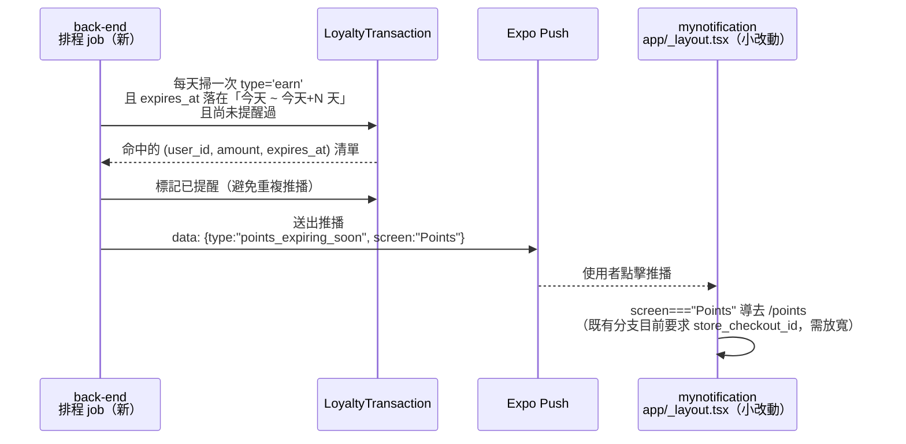

# Plan: 紅利點數即將到期提醒推播

## Goal
點數自入帳日起 1 年後過期（`constants/loyalty.ts`，`LoyaltyTransaction` 的 `type === 'expire'` 已存在，見 CLAUDE.md「紅利點數」章節），但使用者目前完全沒有「快到期了」的事先提醒，只能等點數已經被扣掉、在明細裡看到一筆 `expire` 交易才知道。參考航空哩程、Starbucks 點數到期提醒的做法，新增一個**到期前 N 天**的推播提醒，讓使用者有機會在點數失效前花掉。

完成的定義：使用者的某筆 `earn` 點數即將在 N 天內到期時，收到一則推播，點擊後導去「紅利點數」畫面；同一筆即將到期的點數不會重複提醒。

## Architecture / flow

## Scope

### May modify（mynotification）
- `app/_layout.tsx` 的 `navigateFromNotificationData` — 現有分支是 `data.screen === "Points" && data.store_checkout_id`，只有門市收銀完成推播會觸發；這次的提醒推播不會帶 `store_checkout_id`，要把條件放寬成「`screen === "Points"` 就導頁，`store_checkout_id` 存在時才額外 `invalidateQueries`」，兩種來源才能共用同一個 `screen` 值而不互相卡住
- `types/notification.ts` 的 `NotificationData` 註解補上第三種 `screen: "Points"` 的來源（`type: "points_expiring_soon"`，無 `store_checkout_id`）
- `app/points.tsx` 不需要改：畫面本來就會顯示最新餘額與明細，使用者點進來後自己會看到哪筆快過期

### 不在 mynotification 範圍內（2026-10-12 跟 back-end 對齊定案，尚未排入開發）
- `LoyaltyTransaction` 新增 nullable `reminded_at`（`DateTime`）——back-end 評估後認為這是比另開記錄表更自然的做法，跟既有 `expire_loyalty_points_task` 同一種「掃單筆 `earn` 紀錄」邏輯一致，只是條件換成 `expires_at BETWEEN now AND now+7天 AND reminded_at IS NULL`
- 排程：掃出的列先在程式裡依 `user_id` 分組、加總 `remaining_amount` 當作文案的點數數字，推完一個使用者就把這批列的 `reminded_at` 一起標記（即使推播失敗也標記，比照現有「DB 交易成功就算數、推播是 best-effort」慣例）
- 排程時間訂在 **UTC 2am（台灣時間早上 10 點）**，刻意跟既有到期排程（`expire_loyalty_points_task`，UTC 1am）錯開，也避免太早吵醒使用者；兩個排程的篩選條件本來就不重疊（一個看未來區間、一個看已過期），不用擔心互相影響
- 推播 payload：`{ type: "points_expiring_soon", screen: "Points" }`，文案帶加總點數，例如「您有 N 點將在 7 天內到期，記得使用！」
- **N 天＝7 天**，已確認採用「今天～今天+7天」區間（不是精確第 7 天），避免排程哪天沒準時跑就漏掉人

### Must not modify
- `constants/loyalty.ts` 的點數規則常數 — 到期規則本身不變，只是新增「到期前提醒」
- `app/points.tsx` 的既有收支明細邏輯 — 不需要在列表上特別標示「即將到期」，使用者點進來自然看得到 `expires_at`

## Existing patterns to follow
- 推播點擊路由：沿用 `app/_layout.tsx` 既有的 `data.screen` 字串比對機制
- 後端排程 job：沿用既有的 `send_birthday_coupons_async_task`（`scheduler_service.py`）同一套模式（排程觸發、彙整收件人、逐一推播）

## Constraints
- 不做「點數到期後自動延長」這類業務規則變動，純粹是**提醒**，到期規則本身不變
- 同一筆快到期點數只提醒一次，不是每天都推播

## Verification
- 後端：排程 job 對正式 DB 跑一次，確認只有「今天～今天+N 天」區間內的 `earn` 交易被選中，且標記後不會重複選中
- 前端：手動觸發一則 `{ type: "points_expiring_soon", screen: "Points" }` 的測試推播，點擊後正確導去 `/points`；確認既有的門市收銀推播（`screen: "Points"` + `store_checkout_id`）行為不受影響（仍會 invalidate 對應 query）

## Done definition
- [x] 已跟 back-end 確認排程設計、N 天數字、防重複提醒機制
- [x] `app/_layout.tsx` 放寬 `Points` 分支條件，`tsc`/`lint` 乾淨
- [x] 後端部署並對正式 DB 跑過一次驗證（commit f0d10e2，2026-10-12 已 push、Render 已部署；`LoyaltyTransaction` 新增 `reminded_at`，migration `6f945837c680`；本機用拋棄式測試帳號+假 Expo client 對正式 DB 端到端驗證過：窗口內未提醒才標記、窗口外/已消耗/已過期都不動、同使用者合併成一則、已提醒不重複、重跑排程 idempotent；測試殘留資料已清除）
- [x] 排程時區一併修正：三支排程（生日禮券、既有點數到期、這支新的到期提醒）都改成明確 `timezone=ZoneInfo("Asia/Taipei")`（Python 3.12 內建 `zoneinfo`），不再依賴伺服器預設時區；**會改變前兩支既有排程的實際觸發時間**（如果 Render 之前實際是 UTC，會往後移 8 小時）——back-end 已跟他的使用者確認過才套用，日後觀察到生日禮券/點數到期排程觸發時間點有變化屬於預期結果，不是 bug
- [x] 手動觸發測試推播驗證導頁正常（2026-10-12 使用者實機確認：back-end 手動觸發 `points_expiring_soon` 推播，收到通知、點擊後正確導到「紅利點數」畫面）；既有門市收銀推播（帶 `store_checkout_id`）這次沒有另外重測，但該分支邏輯只是在原本判斷式外加了 `if (data.store_checkout_id)` 包住既有 invalidate 呼叫，程式碼未變動，風險低
- [ ] Commit

## Risks & rollback
- 風險：N 天設太短（例如 1 天）使用者來不及反應；設太長則提醒變得沒有急迫感，可能需要之後調整，目前先抓 7 天當起始值
- Rollback：`app/_layout.tsx` 的條件放寬是只增加分支範圍、不影響既有行為，`git diff` 還原即可；後端排程 job 是新增，移除即可，不影響既有到期扣點邏輯

## Open questions
- 已解決：N 天＝7 天、防重複提醒用 `reminded_at` 欄位、排程時間 UTC 2am，皆已跟 back-end 對齊（2026-10-12）
- **排程時區未明確指定**（2026-10-12 使用者提出，back-end 已查證確認風險屬實）：back-end 查過開發機器系統時區確實是 Asia/Taipei（不是 UTC），證實「本機測試 vs Render 正式環境」觸發時間不一致是真實存在的風險，不是假設性的；但 Render 正式環境實際時區無法 100% 證實（試圖用生日禮券排程過去的 `NotificationLog.created_at` 反推，但找到的紀錄時間跟 cron 設定對不上，研判是先前手動測試留下的資料，不是真正排程觸發，無法用來反推）。
  - back-end 同意解法：改用 Python 3.12 內建 `zoneinfo`（不需額外裝 `pytz`），在 `BackgroundScheduler` 明確指定 `timezone`，建議直接設成 `Asia/Taipei`（而非 UTC），cron 的 `hour` 就是台灣當地時間，不用每次心算 UTC+8
  - **這會動到兩支已上線的既有排程**（生日禮券 `day=25,hour=0`、點數到期 `expire_loyalty_points_task` `hour=1`）：如果 Render 實際上真的是 UTC，明確指定時區後這兩支的實際觸發時間會延後 8 小時——這是會改變正式環境既有行為的異動，back-end 要先跟他的使用者確認才會動工，確認後會把新提醒排程跟這兩支既有排程**一起**套用明確時區（不會只修一半留著不一致）
- 兩邊都還沒排入開發，確認要排入時再互相通知
