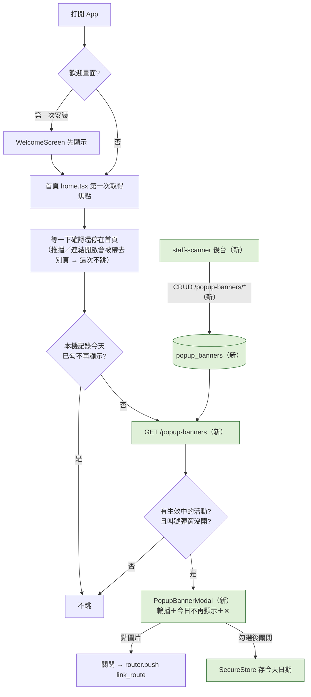

# Plan：首頁開屏活動彈窗（Popup Banner）

## 目標

打開 App 進首頁時，畫面中央跳出大圖活動彈窗（可左右滑的多張輪播），用來強打年度大活動、抽獎、重大公告。參考使用者 2026-11-09 提供的 HAPPY GO 截圖：背景變暗、置中大圖、下方小圓點、「今日不再顯示」勾選框、關閉 ✕ 按鈕，點圖片進活動頁。

完成的定義：店員 App 後台可以新增／下架彈窗活動（圖片、點擊導頁、上下架時間、排序）；顧客打開 App 進首頁時，有生效中的活動就跳出彈窗；勾「今日不再顯示」後當天不再跳。

### 使用者 2026-11-09 定案的決策

| 題目 | 決定 |
|---|---|
| 頻率 | **每次進到首頁都跳**（打開 App 落在首頁、從其他分頁或畫面回到首頁；使用者實測後改成跟 HAPPY GO 一樣，原本只有打開 App 才跳）；從背景切回來不跳 |
| 今日不再顯示 | 勾了**整個彈窗當天都不跳**（台灣時間，隔天 00:00 恢復） |
| 錯開 | 歡迎畫面關掉、進到首頁才跳；**取餐叫號彈窗優先**（叫號彈窗出現時開屏彈窗不跳）；從推播或連結打開 App（直接到別的畫面）這次不跳 |
| 管理 | **店員 App 後台管理**，比照大輪播 |

## 規則（提案）

- 只顯示「啟用中且在上下架時間內」的活動，依排序；沒有就不跳
- 圖片建議比例 **4:5（直式，例如 1080×1350）**，彈窗寬度約螢幕 85%，圖片完整顯示不裁切
- 點圖片：關閉彈窗後導到該活動的 `link_route`；沒設定就只是看，不導頁
- `link_route` 沿用大輪播的路徑白名單（`constants/heroBannerRoutes.ts`，三方共用同一份），不另外維護一份；**使用者 2026-11-09 決定從 8 個加到 10 個**：新增 `/referral`、`/points-exchange`，大輪播也能用
- 「今日不再顯示」記在**裝置本機**（SecureStore 存台灣日期），不同步後端；換手機或重裝會重新顯示

## 架構／流程



## API 契約（提案，待 back-end 確認，比照 hero-banners）

**公開**：`GET /api/v1/popup-banners`（不需登入）
```json
[
  { "id": 1, "title": "2026 兌最大", "image_url": "https://.../popup/xxx.jpg", "link_route": "/points" }
]
```
- 只回 `is_active` 且在 `start_at`／`end_at` 區間內，依 `sort_order` 排序
- `image_url` **必填**（彈窗是純圖片）；`link_route` 可為 `null`；`title` 給無障礙朗讀與後台辨識用，畫面上不顯示

**管理**（`verify_admin_or_staff` 雙軌授權，只給 staff-scanner）：比照 hero-banners
- `GET /api/v1/popup-banners/admin`（全部，含未啟用、已過期）
- `POST /api/v1/popup-banners`、`PATCH /api/v1/popup-banners/{id}`、`DELETE /api/v1/popup-banners/{id}`
- 欄位：`title`、`image_url`、`link_route`、`sort_order`、`is_active`、`start_at`、`end_at`；`link_route` 不在 10 個白名單內回 422
- 圖片沿用 Supabase `promotions` bucket，檔名前綴 `popup/`

## Scope

### May modify（mynotification）
- `components/PopupBannerModal.tsx`（新）— 全螢幕半透明背景、置中輪播（`react-native-reanimated-carousel`，已安裝）、小圓點、「今日不再顯示」勾選、✕；圖片固定 4:5 容器 `contentFit="contain"`（`expo-image`）
- `services/popupBanners.ts`（新）— `fetchPopupBanners()`、本機「今日不再顯示」讀寫（SecureStore）
- `app/(drawer)/(tabs)/home.tsx` — 掛彈窗；控制「這次打開 App 只判斷一次」與「確認還停在首頁才跳」；叫號彈窗開著時不跳
- `CLAUDE.md`

### Must not modify
- 大輪播、小輪播既有邏輯；`constants/heroBannerRoutes.ts` 只引用不改
- `components/WelcomeScreen.tsx`、`components/PickupCallModal.tsx`

### 分工
- **back-end**：`popup_banners` 表、公開與管理 API
- **staff-scanner**：彈窗活動後台（比照大輪播後台：列表、新增／編輯、選圖上傳、導頁下拉選單、上下架時間、排序、啟用開關），建議在上傳畫面提示 4:5 比例

## 驗證
1. **正常顯示**：店員 App 新增 2 張生效中的彈窗 → 顧客完全關閉 App 再打開 → 首頁跳出彈窗、可左右滑、小圓點正確；點圖片會關閉並進到設定的頁面
2. **今日不再顯示**：只按 ✕ → 關掉 App 再開還會跳；勾「今日不再顯示」再關 → 關掉 App 再開不跳；（隔天會再跳，可以請 back-end 協助或改手機日期驗證）
3. **不該跳的情況**：店員 App 把活動全部下架或過期 → 不跳；點推播打開 App（直接到優惠券頁）→ 不跳；從背景切回 App → 不跳
- 深色模式：背景遮罩與按鈕看得清楚

## 完成條件
- [x] back-end 部署（`c803e97`，migration `b385b1204eb7`）
- [x] staff-scanner 後台完成（`08bcce1`，入口改名「首頁活動管理」）
- [x] 前端完成，驗證 1～3 實機通過（2026-11-09。實測修了三個問題：判斷寫在 home.tsx 讓 FlashList 無限重新渲染 → 搬到彈窗元件自己判斷；首頁路徑是 `/` 不是 `/home`；Modal 內要另包 GestureHandlerRootView 才能左右滑。並依使用者要求改成每次回到首頁都跳、切回首頁不等待）
- [x] CLAUDE.md 更新

## 風險與還原
- 風險：圖片很大、網路慢時彈窗晚好幾秒才出現，使用者已經在滑首頁。處理：先等圖片載完才開彈窗；超過 5 秒還沒載完這次就不跳
- 風險：每次開 App 都跳，使用者可能覺得煩。處理：「今日不再顯示」；活動數量建議不超過 3 張
- 還原：店員 App 全部下架即可立即停止；前端拿掉元件即可

## Open questions
- ~~白名單要不要加 `/referral`、`/points-exchange`~~ → 加（10 個，三方同步）
