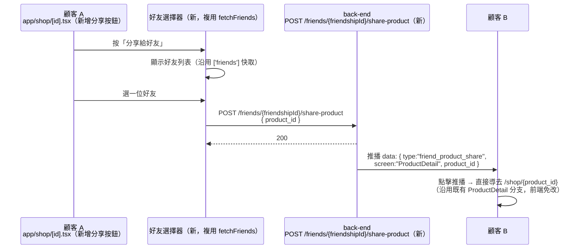

# Plan: 商品分享給好友

## Goal
好友功能（`plan-friends.md`）上線後，好友之間只能傳固定的快速訊息，沒辦法分享「這個商品不錯」。參考蝦皮/Shopee「分享給朋友」的體驗，在商品詳情頁加一個分享按鈕，選一位好友送出，對方收到推播並直接導去該商品的詳情頁。

完成的定義：在 `app/shop/[id].tsx` 選一位好友並送出分享，對方收到推播、點擊後導去該商品詳情頁；分享沒有訊息輸入框（比照好友快速訊息「不開放自由輸入文字」的既有原則）。

## Architecture / flow

## Scope

### May modify（mynotification）
- `app/shop/[id].tsx` — 新增「分享給好友」按鈕（比照收藏愛心按鈕的位置邏輯，放在商品資訊區塊），按下開啟好友選擇器
- `components/FriendPickerSheet.tsx`（新，暫定名）— 底部彈出的好友選擇清單，複用 `services/friends.ts` 的 `fetchFriends()` 與 `['friends']` 快取，點選後呼叫分享 API 並關閉；沒有好友時顯示引導文字（去好友頁加好友）
- `services/friends.ts` — 新增 `shareProduct(friendshipId: number, productId: number): Promise<void>`
- `types/notification.ts` 的 `NotificationData` 註解補上 `friend_product_share` 這個來源共用既有的 `ProductDetail` 格式（`screen: "ProductDetail"`、`product_id`），**不需要新增導頁分支**——這是這個功能能直接沿用現有商品到貨/降價推播同一套路由的原因

### 不在 mynotification 範圍內（2026-10-12 跟 back-end 對齊定案，尚未排入開發）
- 新端點 `POST /api/v1/friends/{friendshipId}/share-product`，body `{ product_id }`
- 驗證：呼叫者是這段好友關係的一方，**且該關係 `status == "accepted"`**（跟 `send_greeting` 端點一致——back-end 指出只檢查「是不是這段關係的一方」還不夠，pending／declined 的關係不應該能分享商品，否則跟「要互相確認才成立好友」的精神不一致）；不是成員回 404，不是 accepted 回 **409**「還不是好友」
- 驗證：`product_id` 存在**且 `is_active`**（已下架一併回 404），比照 `GET /products` 公開端點只回上架商品的慣例
- 推播 payload：`{ type: "friend_product_share", screen: "ProductDetail", product_id }`（刻意跟既有收藏到貨/降價推播用同一組 `screen`/`product_id` 格式，B 端點擊後的導頁邏輯完全免改），**並帶 `image_url: product.thumbnail`**（back-end 已有推播帶圖機制，`send_user_push_notifications` 的 `image_url` 選填參數可直接沿用，商品縮圖本來就是 https 網址）
- 推播文案，例如「{分享者暱稱} 跟你分享了一個商品」

### Must not modify
- `app/_layout.tsx` 的 `navigateFromNotificationData` — 不需要新增分支，沿用既有 `ProductDetail` 處理
- `app/friends/[friendshipId].tsx` 的快速訊息（`QUICK_MESSAGES`）— 分享商品是獨立入口（商品詳情頁），不是好友卡片上的按鈕，兩者不合併
- 不開放在分享時額外輸入文字訊息（比照快速訊息「不做文字輸入框」的既有原則，避免變成聊天室）

## Existing patterns to follow
- 好友列表資料來源：`services/friends.ts` 的 `fetchFriends()`、`['friends']` 快取
- 推播點擊導頁：完全複用既有 `ProductDetail` 分支（`app/_layout.tsx` 第 118 行一帶），不新增分支
- 錯誤處理慣例：比照 `sendGreeting` 失敗時的 `detail` 判斷（純文字 `detail` + `Alert.alert`）

## Constraints
- 分享沒有自由輸入文字欄位，避免變成聊天室/內容審核問題（跟好友快速訊息同一條既有原則）
- 只能分享給「已經是好友」的對象，不開放分享給任何 user_id

## Verification
- 端對端（兩台裝置，各登入不同帳號）：
  1. Happy path：A 在商品詳情頁按分享、選 B → B 收到推播、點擊後直接進到該商品詳情頁（而不是先進商店列表，待確認體驗是否需要比照既有「先 push 列表頁再疊商品頁」的模式，見 Open questions）
  2. 錯誤案例：沒有好友時按分享按鈕，顯示引導文字而非空白清單
  3. 錯誤案例：商品已下架後才點擊舊推播，顯示既有「找不到這個商品」畫面（沿用 `shop/[id].tsx` 既有行為，不需額外處理）

## Done definition
- [x] 已跟 back-end 確認端點契約與推播 payload（2026-10-12，含 accepted 狀態檢查、`is_active` 檢查、`image_url` 帶圖，皆已對齊）
- [x] `FriendPickerSheet` 與 `shop/[id].tsx` 改動完成，`tsc`/`lint` 乾淨（已於 commit `598af0b` 一併提交）
- [x] 後端部署（commit `50ffd38`，2026-10-12 已確認 `/openapi.json` 有這支路徑；back-end 用拋棄式測試帳號對正式 DB 跑過所有分支：非成員 404、未 accepted 409、商品不存在/下架 404、成功 200）
- [x] 端對端測試通過（2026-10-12，使用者實機確認：收到推播、下拉通知欄確認有附商品圖、點擊正確導到該商品詳情頁。因只有一台裝置，無法用真實 UI 兩端互測，改由 back-end 直接呼叫分享背後的服務邏輯模擬 hotmail→gmail 分享，推播與導頁行為跟透過 UI 分享會走的程式碼路徑一致，見 Risks 補充）
- [x] Commit（前端已在 `598af0b`，測試過程未發現需要修正的地方，不需額外 commit）

## Risks & rollback
- 風險：分享功能可能被濫用成騷擾管道（連環分享商品），但範圍僅限「已是好友」的對象，風險等級與好友快速訊息相同，暫不額外處理
- Rollback：全部是新檔案 + `shop/[id].tsx` 小範圍新增（按鈕 + 開啟 sheet），`git diff` 還原即可
- **測試方法限制**（2026-10-12）：使用者只有一台實體裝置，沒辦法同時「用分享者帳號登入按分享」又「用收件人帳號登入收推播」——App 的 Push Token 註冊是跟著目前登入的帳號走（見 `services/authFlow.ts`／`(tabs)/_layout.tsx` 的 push-token 同步邏輯），同一支手機同一時間只能代表一個帳號收推播。這次改由 back-end 直接呼叫 `share-product` 背後的服務邏輯（繞過 HTTP 認證層，帶入真實的 `friendship_id`／`product_id`）來模擬「分享者按下分享鍵」這個動作，手機維持登入收件人帳號收推播，這樣除了「按鈕本身觸發 API」這一小段，其餘（服務邏輯驗證、推播組裝與發送、App 端收到推播與導頁）都是走真實程式碼路徑，不是假資料。之後如果有第二台裝置，可以再補一次完全透過 UI 操作的端對端測試，但目前這次驗證已經足夠確認功能正確

## Open questions
- 點擊推播後的導頁體驗：要不要比照 `ProductDetail` 既有模式「先 push 商店列表、再疊商品詳情頁」讓返回鍵能回到列表，還是直接進商品頁、返回鍵回首頁即可（目前商品到貨/降價推播是前者，建議保持一致）
- `FriendPickerSheet` 要不要跟之後其他「選好友」情境（例如如果之後真的做推薦邀請）共用，目前先只為這個功能做
