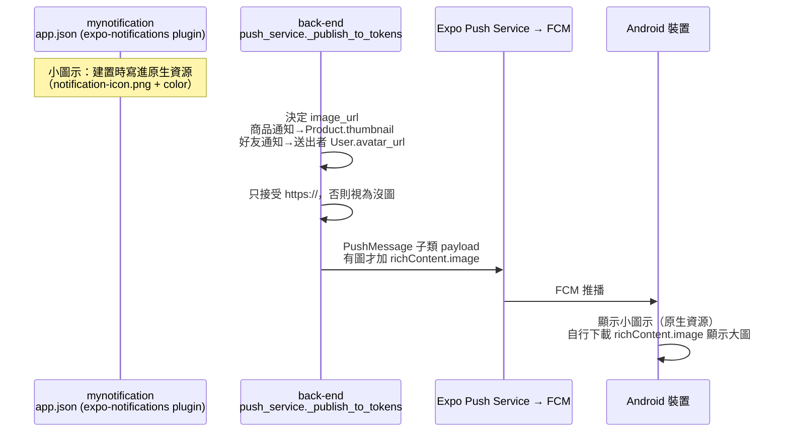

# Plan: 推播通知圖示與圖片（左方 LOGO + 右方大圖）

## Goal
使用者希望推播通知像一般 App 一樣，左邊有品牌 LOGO、右邊（收合時的縮圖／展開後的大圖）有圖片。兩者實作位置完全不同：

- **左方 LOGO（Android 通知小圖示）**：由 App 的原生設定決定，前端負責。`app.json` 加入 `expo-notifications` config plugin 的 `icon`（96×96、透明背景、純白圖案，Android 只取形狀）與 `color`（圖示底色）。**需要重建 Dev Build**。沒設定時 Android 用預設圖示（通常是灰白方塊）。iOS 直接使用 App 圖示，不需設定。
- **右方圖片**：由後端在推播 payload 帶 `richContent: { image: "https://..." }`，前端不用改。**僅 Android**（依 Expo Push API 的說法，back-end 與我這邊都無法在本次查證文件，以實機驗證為準）；iOS 要顯示圖片需要 Notification Service Extension，**這次不做**。

完成的定義：Android 實機收到推播時，狀態列/通知左側是品牌小圖示；收藏商品到貨/降價、好友邀請/接受/快速訊息這幾種通知，右側有對應圖片；沒有圖片來源時（例如沒設大頭貼）通知照常顯示、只是沒圖。

## Architecture / flow

## Scope

### May modify（mynotification，已完成）
- `assets/images/notification-icon.png`（新）— 測試用小圖示：96×96、透明背景、純白鈴鐺剪影（使用者指示為測試目的由前端自行建立，之後有正式品牌圖再替換同一個檔案）
- `app.json` — 新增 `expo-notifications` plugin：`icon: ./assets/images/notification-icon.png`、`color: #7A6A54`（對應 `Colors.light.tint`）
- 重新 `eas build --profile development --platform android`（最終 build `b9cd89a7-a9da-4068-9fc3-3de517e4a311`，已送出；先前的 `ab9c0eba` 因為之後又新增了 `expo-image-manipulator` 原生模組已取消）
- `app/(drawer)/(tabs)/settings.tsx` + `package.json` — 頭貼上傳前縮小：`expo-image-manipulator`（新增原生模組）把寬度大於 512px 的圖縮到 512px、轉 JPEG（compress 0.8）；已經 ≤512px 的不重新編碼。使用者 2026-09-19 決定要做
- 推播圖片本身完全由後端 payload 決定，App 端 `expo-notifications` 收到後由系統顯示，不需其他前端程式碼

### 不在 mynotification 範圍內（back-end，2026-09-19 已評估可行，約 1 小時、不需 migration、尚未排程）
- `exponent_server_sdk` 2.2.0 的 `PushMessage` 不支援 `rich_content`，不需升版：做一個小子類，覆寫 `get_payload()`，有圖時在 payload 加 `richContent: {"image": url}`；沒圖時 payload 與現況完全一致
- `send_user_push_notifications`／`send_role_push_notifications`／`send_favorite_users_notifications` 與內部 `_publish_to_tokens` 新增選填 `image_url: str | None = None`，沒帶的通知行為不變
- 帶圖的通知與來源：
  - 收藏商品到貨／降價 → `Product.thumbnail`（正式 DB 193 個上架商品全是 `https://cdn.dummyjson.com/...`）
  - 好友邀請／接受／快速訊息 → **送出者**的 `User.avatar_url`（Supabase 公開網址；沒設大頭貼就不帶圖，目前正式 DB 僅 1 人有大頭貼）
  - 優惠券／點數／堂食訂單／出貨 → 這次不帶
- 只接受 `https://` 開頭，否則當沒圖；不做 HEAD 檢查（拖慢背景任務、多一個失敗點）
- `NotificationLog.data` **不存** `image_url`（之後 inbox 要縮圖，商品圖可由 `product_id`、頭貼可由對方 user 現查）

### Must not modify
- `app/(drawer)/(tabs)/inbox.tsx` 通知列表 — 這次只做推播本身，不做列表縮圖
- iOS 原生設定 — 不新增 Notification Service Extension

## Existing patterns to follow
- 推播 payload 與 channel 設定：沿用 `push_service._publish_to_tokens` 現有結構（`channel_id="default"`、`sound="default"`）
- 原生設定變更需重建 Dev Build：比照 `google-services.json`／`expo-camera`／LINE SDK 前例

## Constraints
- 小圖示必須是**純白＋透明背景**；彩色圖示在 Android 會被系統染成純白方塊
- 圖片是 **Android 裝置收到通知時自行下載**，Expo 推播伺服器不替我們抓圖，所以網址失效通常只會變成「沒圖的通知」，不會整則失敗
- **大小是弱點**：商品圖是 CDN 縮圖沒問題，但使用者自己上傳的頭貼可能很大，後端發送前無法得知；根治方式在上傳端壓縮（**已處理**：`settings.tsx` 上傳前縮到 512px，但只對之後新上傳的頭貼有效，既有的大頭貼不會回頭縮小）
- **iOS 行為未經驗證**：back-end 與我這邊都查不到依據證明「iOS 收到帶 `richContent` 的推播會被忽略而不出錯」，**不可當成事實**。必須 iOS 與 Android 實機各測一次；若 iOS 有問題，可改成只對 Android token 帶圖，但 `PushToken` 目前沒記錄平台，需另外加欄位再討論
- iOS 目前沒有 Apple Developer 帳號，iOS 實機驗證暫時無法進行

## Verification
- Android 實機（需新 Dev Build，build `b9cd89a7`）：
  1. 小圖示：任一則推播，狀態列與通知左上角是白色鈴鐺、底色為 #7A6A54，不是灰白方塊
  2. 商品通知：收藏商品降價/到貨 → 通知右側顯示商品圖，展開後為大圖
  3. 好友通知：對方有大頭貼時，邀請/接受/快速訊息通知顯示對方頭貼；對方沒設大頭貼時，通知正常顯示、沒有圖
  4. 無圖來源的通知（優惠券、點數、堂食訂單）行為與現在完全相同
  5. 圖片網址失效（測試用假網址）→ 通知仍顯示，只是沒圖
- iOS：待有 Apple Developer 帳號後實機確認帶 `richContent` 的推播仍正常顯示（見 Constraints）
- 頭貼縮圖：設定頁選一張大圖（例如相機原圖）上傳，Supabase 上的檔案寬度應為 512px；選小圖（≤512px）則維持原樣
- 後端：payload 單元驗證（有圖／無圖／非 https 三種）

## Done definition
- [x] 前端：`notification-icon.png` 與 `app.json` plugin 完成
- [x] 前端：頭貼上傳前縮到 512px 完成，`tsc`/lint 乾淨
- [x] 前端：已送出新 Dev Build（`b9cd89a7-a9da-4068-9fc3-3de517e4a311`，含 `expo-camera`、小圖示、`expo-image-manipulator`）
- [ ] 新 Dev Build 安裝後，Android 小圖示驗證通過
- [x] back-end 實作 `image_url`／`richContent` 並 push（commit 8168c0d，2026-09-19；back-end 只用假 Expo client 驗證 payload 格式，無法從外部確認 Render 已部署到此 commit，測試前先確認部署完成）
- [ ] Android 實機驗證右側大圖（商品／好友通知）
- [ ] iOS 驗證（待 Apple Developer 帳號）
- [ ] Commit

## Risks & rollback
- 風險：`richContent` 的細節（Android 限定、圖片大小上限）未經文件查證，全靠實機驗證
- 風險：測試用鈴鐺圖示不是正式品牌 LOGO，上線前要換成正式白色去背圖（同檔名替換 + 重建即可）
- Rollback：`app.json` 移除 `expo-notifications` plugin 並重建；後端 `image_url` 是選填參數，不傳就與現況一致，不需 rollback 資料

## Open questions
- 正式品牌 LOGO（白色去背 96×96）何時提供
- iOS 是否需要支援推播圖片（需 Notification Service Extension，暫不做）
