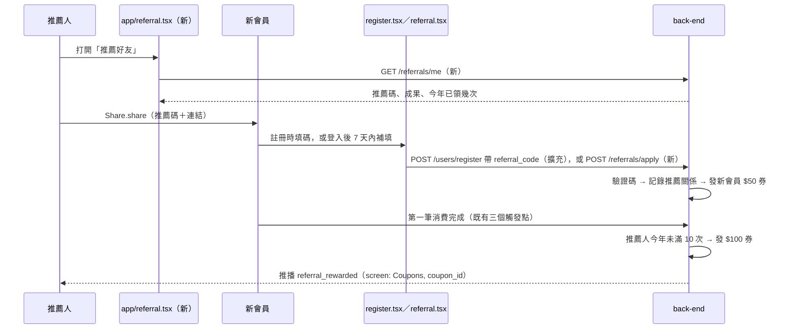

# Plan：推薦好友（Referral）

## 目標

老會員把自己的推薦碼分享給朋友，朋友註冊時填推薦碼，雙方都拿到優惠券，帶進新會員。為了防止註冊假帳號刷獎勵，推薦人的獎勵要等新會員完成第一筆消費才發。

完成的定義：
- 每位會員有固定的推薦碼，在「推薦好友」畫面可以複製、分享，並看到推薦成果
- 新會員在註冊表單或「推薦好友」畫面填碼後，馬上拿到 $50 券
- 新會員第一筆消費完成時，推薦人拿到 $100 券並收到推播

### 使用者 2026-11-08 定案的決策

| 題目 | 決定 |
|---|---|
| 獎勵 | **雙方都送券**：推薦人 $100、新會員 $50（疊在既有 $100 歡迎禮券之上），都是 30 天效期 |
| 發獎時機 | 新會員填碼時**先發新會員的券**；推薦人的券等新會員**第一筆消費完成**才發 |
| 上限 | 推薦人每年（台灣時間自然年）最多領 **10 次**獎勵；超過仍可推薦，新會員照拿，推薦人不再拿 |
| 填碼位置 | **註冊表單選填欄位＋「推薦好友」畫面補填**（給 Google／LINE／Magic Link 自動建立的帳號），補填限註冊 **7 天內**且**還沒消費過** |

## 規則（提案）

- 推薦碼：後端替每位會員產生一組固定的 **6 碼英數**（去掉容易看錯的 0/O/1/I），不分大小寫
- 每位新會員只能被推薦一次，填過不能改；不能填自己的碼
- 「第一筆消費完成」= 跟賺點數一樣的三個時間點：網購付款成功、堂食完成、會員快速結帳。之後取消也不收回推薦人的券（券已發出，簡化處理）
- 刪除帳號：被刪的那方推薦紀錄一併刪除，已發出的券依刪除帳號既有規則處理

## 架構／流程



## API 契約（提案，待 back-end 確認）

**`GET /api/v1/referrals/me`**（需登入）

```json
{
  "code": "K7Q2MX",
  "successful_count": 3,
  "pending_count": 1,
  "rewarded_this_year": 3,
  "yearly_limit": 10,
  "referred_by": null,
  "can_apply_code": true,
  "apply_deadline": "2026-11-15T23:59:59+08:00"
}
```
- `successful_count`：已完成首購的推薦人數；`pending_count`：已填碼、還沒首購的人數
- `rewarded_this_year`：今年推薦人已領幾次獎勵
- `referred_by`：自己是被誰推薦的，例如 `{ "display_name": "小明" }`（有暱稱用暱稱，沒有就遮罩 email，例如 `st***@hotmail.com`），沒有就是 `null`
- `can_apply_code`：現在還能不能補填（註冊 7 天內、沒消費過、還沒被推薦過）；`apply_deadline`：補填期限

**`POST /api/v1/referrals/apply`**（需登入），body `{ "code": "K7Q2MX" }`
- 成功 `201`：`{ "coupon": <新會員 $50 券，同 /coupons/me 格式>, "referred_by": { "display_name": "..." } }`
- 錯誤（`detail` 是帶 `error_code` 的物件，比照點數）：
  - `400 invalid_referral_code`：碼不存在
  - `400 self_referral`：填自己的碼
  - `409 already_referred`：已經填過
  - `409 apply_window_closed`：超過 7 天或已經消費過

**擴充 `POST /api/v1/users/register`**：body 加可選欄位 `referral_code`
- 碼有效：註冊成功，同時記錄推薦關係、發 $50 券（跟歡迎禮券在同一個 transaction）
- 碼無效：`400 { error_code: "invalid_referral_code" }`，**整個註冊不成立**，讓使用者修正或清空欄位再送

**推播**：推薦人拿到獎勵時，`data: { type: "referral_rewarded", screen: "Coupons", coupon_id }`（沿用既有的優惠券推播導頁）

## Scope

### May modify（mynotification）
- `app/referral.tsx`（新）— 我的推薦碼（大字＋複製＋分享）、推薦成果（成功／等待首購／今年已領 N／10）、規則說明；`can_apply_code` 時顯示「輸入推薦碼」區塊與期限
- `app/_layout.tsx` — `userToken` 分支註冊 `referral`（header「推薦好友」）
- `app/register.tsx` — 加選填「推薦碼」欄位；讀 deep link 參數 `ref` 自動帶入；處理 `invalid_referral_code`；成功訊息提到推薦禮券
- `schemas/authSchema.ts` — `registerSchema` 加可選 `referralCode`（6 碼英數，留空可）
- `app/(drawer)/(tabs)/settings.tsx` — 「帳號管理」加「推薦好友」入口
- `services/referrals.ts`（新）、`types/referral.ts`（新）
- `CLAUDE.md`

### 分享內容
`Share.share` 文字：「我在用寶雅電子商城 App，註冊時輸入我的推薦碼 K7Q2MX，就能多拿一張 $50 優惠券！https://fastapi-pj-2.onrender.com/api/v1/referrals/landing?code=K7Q2MX」
- **2026-11-08 改版**：原本直接放 `mynotification://register?ref=` deep link，使用者實測 LINE 不會把自訂 scheme 變成可點連結。改成後端 https 中繼頁 `GET /api/v1/referrals/landing?code=`（back-end `f928e74`，比照 Magic Link redirect）：顯示大字推薦碼、「開啟 App 註冊」按鈕，載入後自動跳 `mynotification://register?ref=<大寫碼>`；只檢查格式不查 DB（避免被拿來試碼），格式不對顯示「推薦碼無效」且不跳轉
- 還沒裝 App 的人點連結不會有反應，所以文字裡一定要寫出推薦碼讓對方手動輸入。之後上架有商店網址再補下載連結
- `mynotification://register?ref=` 只在**未登入**時有效（`register` 在未登入分支）；已登入的人點了不處理

### Must not modify
- 好友功能（`app/friends/*`）、點數、兌換、簽到的既有邏輯
- `services/api.ts`、`store/useAuthStore.ts`

### 分工
- **back-end**：推薦碼產生、推薦紀錄表、兩支 API、註冊擴充、首購觸發發券、每年 10 次上限、推播
- **staff-scanner**：不用改

## 驗證
1. **註冊填碼**：A 在「推薦好友」分享推薦碼 → B 用帳密註冊並填 A 的碼 → 註冊成功，B 的「我的優惠券」有 $100 歡迎券＋$50 推薦券；A 的畫面「等待首購 1 人」
2. **首購發獎**：B 用會員快速結帳消費一筆 → A 收到推播，點開是 $100 推薦禮券；A 的畫面變「成功推薦 1 人、今年已領 1／10」
3. **錯誤情況**：填不存在的碼註冊 → 顯示「推薦碼不存在」、帳號不會建立；B 再補填別人的碼 → 「已經填過推薦碼」；填自己的碼 → 「不能填自己的推薦碼」
- 補填：用 Google 登入一個新帳號 → 「推薦好友」顯示輸入區與期限 → 填碼成功拿 $50 券、輸入區消失
- 上限（back-end 用測試資料驗證）：第 11 位首購時推薦人不再拿券，新會員照拿

## 完成條件
- [x] back-end 部署（`f267f1a`、migration `1f52a8bef9b6`；中繼頁 `f928e74`）
- [x] 前端完成，驗證 1～3 實機通過（2026-11-09：註冊填碼兩張券、填錯碼被擋、首購推薦人收推播＋$100、未登入／冷啟動點 LINE 連結自動帶碼）。**補填尚未實機測**（需要全新 Google／LINE 帳號，back-end 已驗證）
- [x] CLAUDE.md 更新

## 風險與還原
- 風險：推薦碼不存在就整個註冊失敗，使用者可能卡住。處理：錯誤訊息直接說「推薦碼不存在，請確認或清空後再註冊」
- 風險：一個人用多支手機註冊假帳號，再各買一筆小額刷推薦人獎勵。處理：首購門檻＋每年 10 次上限；真的發生再加最低消費金額
- 還原：前端拿掉入口與欄位即可；註冊的 `referral_code` 是可選欄位，舊版 App 不受影響

## Open questions
- 首購要不要有最低金額（例如 NT$100 以上才算）？目前提案不設
- ~~舊帳號能不能補填~~ → 使用者決定不能：後端新增 `users.created_at`，既有 16 個帳號不回填（空值＝期限已過）
- ~~互相推薦~~ → 使用者決定先不擋（同時消費極少數情況可能死結，一筆需重試）
- 推薦成功後要不要自動加為好友？目前提案不做，之後可以加
