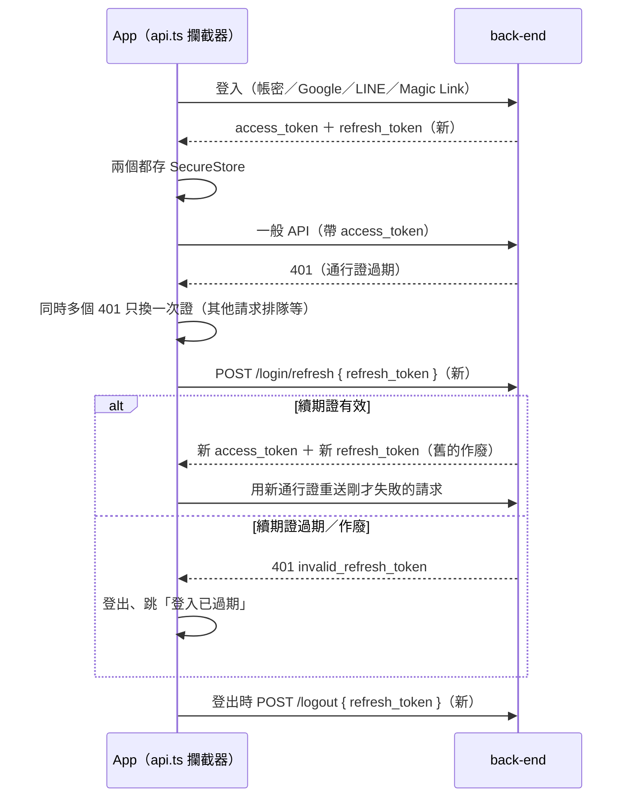

# Plan：登入自動續期（Refresh Token）

## 目標

現在登入只發一張短效的通行證（JWT access token），過期後任何 API 都回 401，App 直接登出、跳「登入已過期」。店員 App 30 分鐘就要重新登入，結帳、核銷做到一半被登出很困擾。

完成的定義：登入時多發一張長效的「續期證」（refresh token）；通行證過期時 App 在背景自動用續期證換一組新的，使用者完全感覺不到；只有太久沒用（顧客 30 天、店員 7 天）才需要重新登入。登出、刪除帳號時續期證立即失效。

### 使用者 2026-11-09 定案的決策

| 題目 | 決定 |
|---|---|
| 範圍 | **店員 App＋顧客 App** 都接（後端同一套） |
| 續期長度 | **顧客 30 天、店員 7 天沒用才要重新登入**（每次換證都重新起算，常用就一直不會過期） |

## 規則（提案）

- 通行證（access token）效期維持後端現在的設定，不變
- 續期證：後端產生的隨機字串（不是 JWT），資料庫只存雜湊值；每台裝置每次登入一張
- **每次換證都換新**（rotation）：用舊的續期證換到新的通行證＋新的續期證，舊的立即失效
- **偷用偵測**：已經換過、失效的續期證又被拿來用 → 視為外洩，該使用者所有續期證全部作廢（全部裝置都要重新登入）
- 寬限：同一張續期證在換證後 **30 秒內**再被用一次（網路重送、App 同時發兩個請求），回傳同一組結果、不算偷用
- 登出：作廢這台裝置的續期證；刪除帳號、角色變更（customer ↔ staff）：作廢該使用者全部續期證
- 舊版 App 不認得 `refresh_token` 欄位，行為跟現在一樣（過期就登出），不受影響

## 架構／流程



## API 契約（back-end 2026-11-09 照提案實作，`75bb360`）

**四個登入端點**（`/login/access-token`、`/login/google`、`/login/line`、`/login/magic-link/verify`）回應多一個欄位：
```json
{ "access_token": "...", "token_type": "bearer", "refresh_token": "..." }
```

**`POST /api/v1/login/refresh`**（不需 Authorization），body `{ "refresh_token": "..." }`
- 成功 `200`：`{ "access_token": "...", "token_type": "bearer", "refresh_token": "<新的>" }`
- 過期、作廢、不存在、帳號已刪除：`401 { "error_code": "invalid_refresh_token", "message": "..." }`

**`POST /api/v1/logout`**（不需 Authorization，通行證可能已過期），body `{ "refresh_token": "..." }` → `204`（找不到也回 204）

**續期長度**：依帳號角色，`customer` 30 天、`staff` 7 天，每次換證重新起算

## Scope

### May modify（mynotification）
- `services/api.ts` — 回應攔截器：401 時先換證再重送（同時多個 401 共用同一次換證）；`/login/refresh` 本身失敗或重送後仍 401 才登出
- `store/useAuthStore.ts` — 多存 `refreshToken`（SecureStore）；`logout()` 呼叫 `POST /logout` 作廢（不等結果、失敗也照常登出）
- `services/authFlow.ts` — `completeLogin(accessToken, refreshToken?)`
- `app/index.tsx`、`app/magic-login.tsx` — 四個登入呼叫帶入 `refresh_token`
- **改用共用 `api` 實例**（不然吃不到自動換證）：`app/(drawer)/(tabs)/inbox.tsx`、`app/(drawer)/(tabs)/settings.tsx`、`app/(drawer)/(tabs)/_layout.tsx` 目前直接用 `axios` 手動帶 token
- `CLAUDE.md`

### Must not modify
- 各功能的業務邏輯；`services/api.ts` 的 request 攔截器行為（仍從 SecureStore 讀通行證）

### 分工
- **back-end**：`refresh_tokens` 表（使用者、雜湊、到期、作廢時間、換出的下一張）、四個登入端點回傳、`/login/refresh`（rotation＋偷用偵測＋30 秒寬限）、`/logout`、刪帳號／改角色時全部作廢
- **staff-scanner**：比照 mynotification 改攔截器與登入／登出（它有自己的 axios 實例與登入畫面）

## 驗證
1. **自動續期**：請 back-end 暫時把通行證效期調成 1 分鐘（或用測試帳號）→ 登入後等 2 分鐘再操作（例如進紅利點數、店員結帳）→ 畫面正常、沒有被登出；`adb logcat` 看得到換證請求
2. **續期證失效**：登出後用舊的續期證換證 → 401；在 A 手機登入、刪除帳號 → A 手機下次操作被登出
3. **同時多個請求過期**：首頁一次發好幾個 API 都 401 → 只換一次證、全部重送成功，不會跳兩次「登入已過期」
- 舊版 Dev Build／Preview 版沒改程式：照舊過期就登出，不壞

## 完成條件
- [x] back-end 部署（`75bb360`，migration `6f14b35c9119`）
- [x] staff-scanner 完成（`a37418c`）
- [x] mynotification 完成，驗證 1、3 實機通過（2026-11-09：用 `SHORT_ACCESS_TOKEN_USER_IDS=1,16` 讓通行證 1 分鐘，adb logcat 看到顧客 App 連續兩次自動續期成功；店員 App 3 個請求同時 401 只換一次證、全部重送成功）。驗證 2（登出／刪帳號後續期證失效）由 back-end 與 staff-scanner 打 API 驗證
- [x] CLAUDE.md 更新

## 風險與還原
- 風險：換證邏輯寫錯，使用者每次 401 就被登出或無限換證。處理：重送只試一次；`/login/refresh` 的請求不經過換證邏輯
- 風險：續期證外洩等於帳號被盜 30 天。處理：只存 SecureStore（加密）、後端只存雜湊、rotation＋偷用偵測
- 還原：前端拿掉換證邏輯就回到現在的行為；後端新欄位與端點都是新增的

## Open questions
- ~~通行證效期~~ → 30 分鐘，customer 與 staff 一樣（Render 若另設 `ACCESS_TOKEN_EXPIRE_MINUTES` 以它為準）
- back-end 實作：30 秒寬限是「再發一組新的、前一組仍有效」（DB 只存雜湊拿不回原組）；續期證記錄發證當下角色，換證時角色不同就全部作廢；測試用環境變數 `SHORT_ACCESS_TOKEN_USER_IDS`（指定帳號通行證 1 分鐘）
- 要不要在 App 裡顯示「登入中的裝置」並可遠端登出？這次不做
