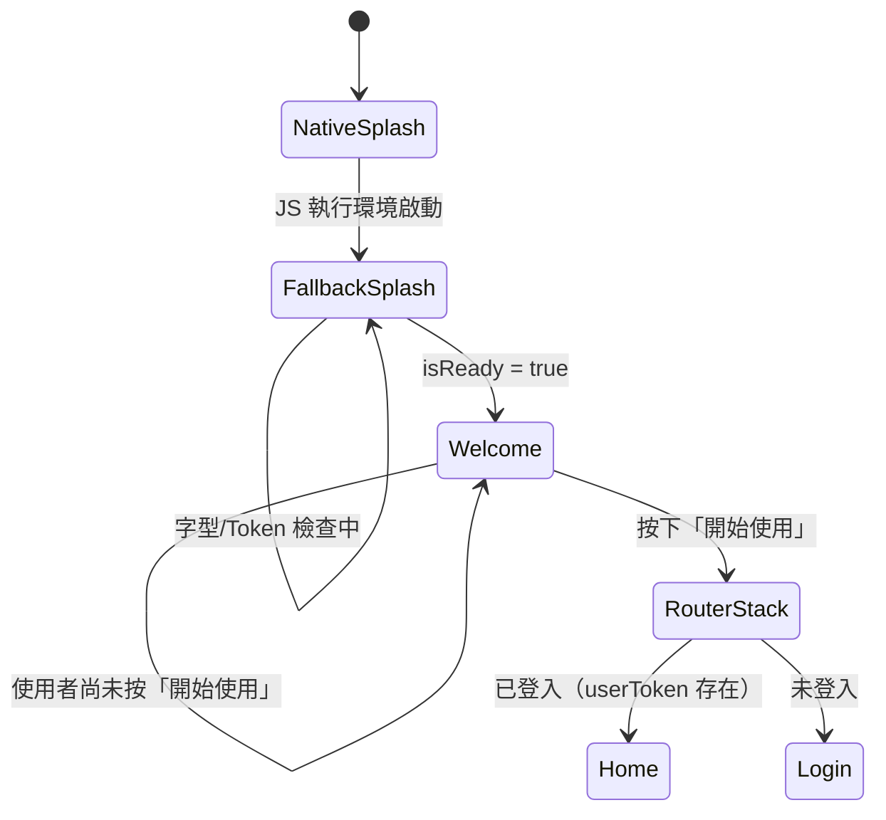

# Plan: 開場 Splash Screen 改版 + 新增 Welcome Screen

## Goal
App 啟動流程目前是「原生 Splash（純圖示，無文字，無固定時間）→ 字型/登入狀態就緒 → 直接進首頁或登入頁」。使用者希望：
1. **Splash Screen 本身要改版**——換成電商風格的圖片＋文字（品牌名稱＋標語），不是現在的空白單圖示。
2. **Splash 之後、進首頁或登入頁之前，新增一個獨立的 Welcome Screen**——單頁設計：品牌 Logo/標語 + 一個「開始使用」按鈕，**每次關閉 App 再重新打開都會顯示**（不論當下是否已登入），按下按鈕才繼續往下走（已登入進首頁、未登入進登入頁）。

完成的定義：App 從完全關閉的狀態重新開啟，依序看到「原生 Splash（新圖樣）→ Welcome 畫面 → 按下開始使用 → 首頁或登入頁」，不會有任何畫面之間露出空白的情況。

## Architecture / flow

## Scope

### May modify
- `app.json` — `expo-splash-screen` plugin 設定：`image` 換成新的電商風格合成圖，新增 `dark.image`（原本只有 `dark.backgroundColor`，深色模式現在也要換圖）
- `assets/images/splash-icon.png`（**覆蓋既有檔案**，已先確認是 git 追蹤的檔案，若不滿意可用 `git checkout -- assets/images/splash-icon.png` 還原）、新增 `assets/images/splash-icon-dark.png`、新增 `assets/images/welcome-product.png`（純去背商品圖，無文字，給 Welcome Screen 用）
- `components/FallbackSplash.tsx` — 改成依 `useResolvedScheme()` 顯示對應的 light/dark 圖，跟原生 Splash 保持一致
- `components/WelcomeScreen.tsx`（新）— Welcome 畫面本身，單純的 React 元件（不是 Expo Router 路由），比照 `FallbackSplash.tsx` 的定位：一張全螢幕畫面，吃 `onContinue` callback
- `app/_layout.tsx` — 新增 `hasSeenWelcome` 狀態，`isReady` 之後、渲染主要 `Stack` 之前先渲染 `WelcomeScreen`，按下按鈕才切換渲染 `Stack`（原本的 `Stack.Protected` 登入/未登入分流完全不動，Welcome 純粹是疊在它前面的一層）

### Must not modify
- `app/_layout.tsx` 裡 `Stack.Protected` 的登入/未登入分流邏輯本身——不改動，Welcome 只是多一層「要不要渲染 Stack」的開關，不涉及改動原本的路由保護機制
- `app/index.tsx`（登入頁）、`(drawer)` 內的所有畫面——這次不改內容，只是「什麼時候看得到它們」多了一關
- 不做「只給新使用者看一次」的版本（已跟使用者確認是每次重開都要看，不用 SecureStore/AsyncStorage 記錄是否看過）

## Existing patterns to follow
- 全螢幕佔位元件：比照 `components/FallbackSplash.tsx` 的寫法（純 `View` + `Image`，不是路由，用 `useThemeColors()`/`useResolvedScheme()` 取色）
- 按鈕樣式：比照 `app/register.tsx` 的主要按鈕（`colors.tint` 底、`colors.onTint` 文字）
- 電商素材取材：比照 `app/(drawer)/(tabs)/home.tsx` 的大輪播／`PromoCarousel`，抓 DummyJSON 的真實商品照片做展示用素材（選的是 `sunglasses` 分類裡的 Classic Sun Glasses 照片，沒有明顯品牌字樣）
- 沒有 header 的全螢幕畫面要包 `SafeAreaView`（`react-native-safe-area-context`），比照 `app/index.tsx`／`app/magic-login.tsx`

## Constraints
- 原生 Splash（`app.json` 設定的這張）是靜態圖片，**手機開啟 App 當下、JS 都還沒執行就會顯示**，沒辦法做成即時抓網路圖片、也沒辦法用 React 元件疊文字上去——所以文字（品牌名稱＋標語）必須直接合成進圖片本身，不是即時渲染的
- Welcome Screen 則是正常的 React 畫面（JS 已經在跑），所以文字/按鈕都是即時渲染、會跟著主題色走，不是圖片的一部分——商品圖本身是去背透明圖（`welcome-product.png`），疊在畫面上，不是另外合成好文字的圖
- 深色模式：原生 Splash 現在會依系統/使用者設定顯示不同的合成圖（light 米白底／dark 深棕底，文字顏色各自對應），這是新增的能力（原本 `app.json` 只有 `dark.backgroundColor`，圖片是共用同一張）
- **這是原生設定變更**（`app.json` 的 `expo-splash-screen` plugin），改完**需要重新 `eas build`** 才會反映在 Dev Build 上，單純 reload JS 不會讓新的原生 Splash 生效；但 Welcome Screen 本身是純 JS 元件，不需要重建

## Verification
- 3 個端對端測試：
  1. Happy path（已登入帳號）：完全關閉 App → 重新開啟 → 依序看到新版原生 Splash → Welcome 畫面 → 按「開始使用」→ 直接進首頁，整段過程沒有露出空白畫面
  2. Happy path（未登入／剛登出）：同上流程，但按「開始使用」後應該進登入頁，不是首頁
  3. 深色模式：手機系統設定（或 App 內「外觀模式」）切到深色，重複測試 1，確認原生 Splash 跟 Welcome 畫面都是深色對應的圖樣與配色，不是淺色圖硬套在深色底上
- 手動驗證：Magic Link 深層連結冷啟動（見 Risks，這個情境下 Welcome 畫面是否要攔住、或是否要跳過，需要使用者確認後再測）
- 不需要壓力測試，這是純展示性的啟動流程，沒有長時間執行的疑慮

## Done definition
- [x] 新的 Splash 合成圖（light/dark 各一張）與 Welcome 用的去背商品圖都已確認滿意
- [x] `app.json`、`FallbackSplash.tsx`、`WelcomeScreen.tsx`、`app/_layout.tsx` 改完，`tsc`/`lint` 乾淨
- [ ] 重新 `eas build --profile development --platform android`（已送出，build `b013e446-5232-446b-b8d2-51cd0410d770`），新 Dev Build 裝上後 3 個端對端測試待使用者實機驗證
- [ ] Magic Link 冷啟動情境的行為待實機驗證（設計上已接受「多按一次」，見 Open questions）
- [ ] Commit

## Risks & rollback
- 風險：**Magic Link 深層連結衝突**——`app/_layout.tsx` 現有設計刻意把 `magic-login` 這個畫面放在 `Stack.Protected` 判斷之外，確保不論登入狀態都能被導航到；但如果 Welcome 畫面擋在整個 `Stack` 渲染之前，使用者從信箱點 Magic Link 冷啟動 App 時，會先看到 Welcome 畫面、按下「開始使用」後才會真正導航到 `magic-login` 完成登入，多一次點擊。這次先接受這個小落差（多按一下），不特別偵測「是不是透過深層連結開啟」來跳過 Welcome，之後如果體感太差再處理
- 風險：`assets/images/splash-icon.png` 是直接覆蓋既有檔案（原本是純圖示、無文字），已確認是 git 追蹤檔案，不滿意可用 `git checkout -- assets/images/splash-icon.png` 還原
- Rollback：`app.json` 的 Splash 設定與新增的三個圖片檔案都是獨立改動，`git diff`/`git checkout` 可以完整還原；`WelcomeScreen.tsx`／`app/_layout.tsx` 的改動範圍小且集中，还原也單純

**實機測試發現並已修正（2026-10-13）**：`FallbackSplash.tsx`（字型/登入狀態檢查中顯示的純圖片）跟後面的 `WelcomeScreen` 視覺上刻意延續（同樣的標題/商品照風格），使用者分不出兩者是不同階段，會覺得「畫面一開始沒有按鈕，等一陣子按鈕才冒出來」，不知道前段在等什麼。已在 `FallbackSplash.tsx` 疊一個轉圈動畫在大概是 Welcome 按鈕會出現的位置，換成 Welcome 畫面時轉圈被真正按鈕取代，體感連續。純 JS 改動，不需要重建。

## Open questions
- 全部已確認（2026-10-13）：商標疑慮已解決（改用無品牌字樣的太陽眼鏡照片）；文案「寶雅電子商城」／「發現好物，從這裡開始」OK；Magic Link 多按一次的落差可接受，不做額外偵測；Welcome 視覺風格（淺色米白／深色炭褐底 + 商品圖置中 + 文字）OK。計畫已核准，開始實作
